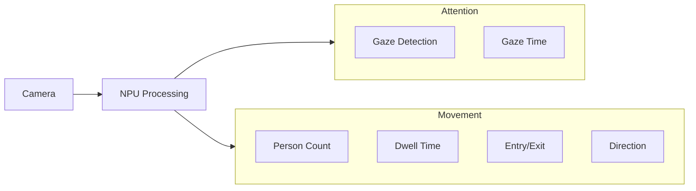
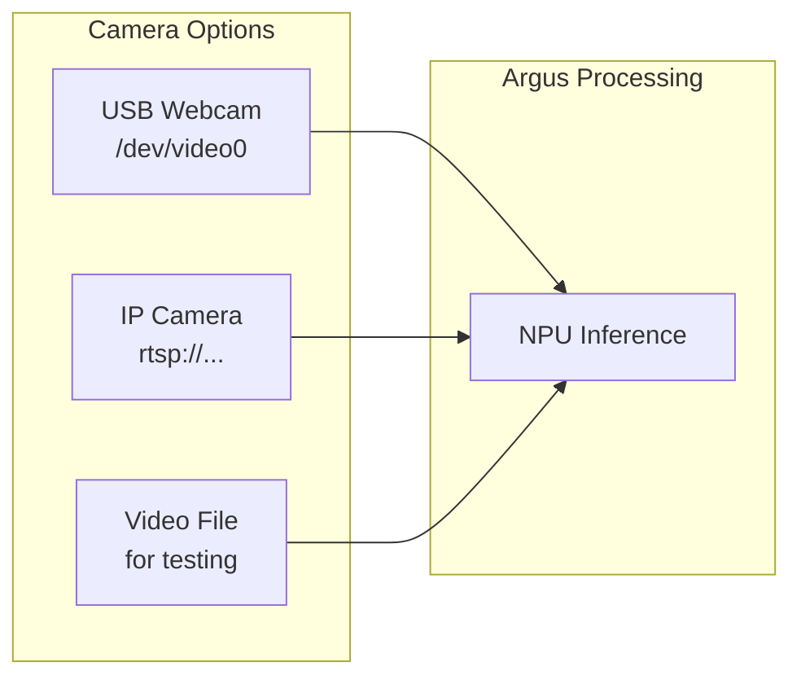
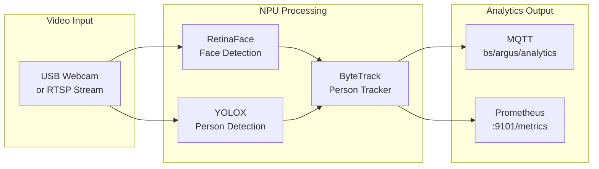

<p align="center">
  
</p>

# Argus Audience Measurement Extension

**Edge AI for real-time audience analytics on BrightSign players**

Argus is a **machine vision application** that analyzes live video from a camera to measure audience behavior. Connect a USB webcam or an IP camera via RTSP, and Argus uses neural network inference on the device's NPU to detect people, track their movement, and determine if they're looking at your display.

Transform your BrightSign digital signage player into an intelligent audience measurement system. Understand not just *who* is in front of your display, but *how* they're engaging with it.

> ## Building from source? Read [docs/PRE-REQS.md](docs/PRE-REQS.md) first
>
> This repo does **not** contain the cross-compile SDK, the RKNN toolkit, or the
> compiled models. They live in a **shared build cache outside the repo**, built
> once per box by the sibling [`brightsign-sdk-builder`](https://github.com/brightsign/brightsign-sdk-builder)
> repo and reused. **[docs/PRE-REQS.md](docs/PRE-REQS.md)** explains the SDK, how to
> populate the cache, and how to point this repo at it via `cache.env`.
>
> On a box that already has the cache: set `BS_CACHE_DIR` in `cache.env`, run
> `make cache-info`, then `make package`.
>
> *(Installing the prebuilt extension instead? Skip to [Quick Start](#quick-start).)*

## The Name "Argus"

In Greek mythology, Argus Panoptes ("all-seeing") was a giant with a hundred eyes who served as an ever-watchful guardian. The name fits an audience measurement system that uses computer vision to observe and understand how people engage with digital displays.

## Release Status

**BETA.** The `analytics/v7.0` MQTT schema and the `argus_*` Prometheus metric names are stable —
they will not change without a schema version bump.

Performance tuning and hardware validation are ongoing. Suitable for pilots and integration work;
validate on your own hardware before wide rollout.

## What Argus Measures

| Measurement | Description |
|-------------|-------------|
| **Person Count** | How many people are currently in view |
| **Gaze Detection** | Is each person looking at the screen? |
| **Gaze Time** | How long has each person been looking? |
| **Dwell Time** | How long has each person been in the area? |
| **Entry/Exit** | When people enter or leave the frame |
| **Direction** | Which way are people moving? (8-way compass) |
| **Speed** | How fast are people moving? |

## Quick Start

You can install this extension on any BrightSign player with an NPU. Download the latest
[Argus BSFW package](https://github.com/brightsign/argus-audience-measurement-extension/releases/latest),
copy it onto the root of an SD card, install the card in the player, and reboot.

Plug a camera into the USB port of the player, or, for advanced setup, you can
[configure Argus to read an RTSP network video stream](docs/CONFIGURATION.md).

From another host on your network do:

```bash
mosquitto_sub -h <PLAYER_IP> -t 'bs/argus/#' -v
```
You should see something like:

```bash
bs/argus/analytics {"schema":"analytics/v7.0","ts":7228.91,"device":"BS-90AC3F2BF3C0","stream":"/dev/video1","frame_w":640,"frame_h":480,"model":"yolox_s","fw_version":"7.0.0","npu_load":0.0,"people":0,"people_confident":0,"gaze":0,"fps":29,"roi":{"type":"border","border_frac":0.30,"rect":[192,144,448,336]},"health":{"detector_fps":29.0,"tracker_fps":29.0,"queue_latency_ms":0,"dropped_frames":0,"last_model_reload_ts":0.0},"tracks":[]}
bs/argus/analytics {"schema":"analytics/v7.0","ts":7229.91,"device":"BS-90AC3F2BF3C0","stream":"/dev/video1","frame_w":640,"frame_h":480,"model":"yolox_s","fw_version":"7.0.0","npu_load":0.0,"people":0,"people_confident":0,"gaze":0,"fps":29,"roi":{"type":"border","border_frac":0.30,"rect":[192,144,448,336]},"health":{"detector_fps":29.0,"tracker_fps":29.0,"queue_latency_ms":0,"dropped_frames":0,"last_model_reload_ts":0.0},"tracks":[]}
```

If so, you're good!  See the [MQTT message format guide](./docs/mqtt-message-format.md) for information on the format.

## Solution Description




## Camera Input

Argus works with any camera that provides a video feed:



| Input Type | Example | Use Case |
|------------|---------|----------|
| **USB Webcam** | `/dev/video0` | Simple setup, direct connection |
| **RTSP Stream** | `rtsp://192.168.0.100:8554/live` | IP cameras, PoE cameras, existing infrastructure |
| **Video File** | `/storage/sd/test.mp4` | Testing and development |

**Typical setup:** Mount a camera facing the audience area in front of your digital sign, connect via USB or network, and Argus continuously analyzes the video stream.

## Key Features

- **Flexible camera support** - USB webcams, RTSP/IP cameras, or video files
- **Real-time analytics** - Sub-second latency from camera to data
- **Per-person tracking** - Stable IDs track individuals across frames
- **Dual output** - MQTT for real-time streaming, Prometheus for dashboards
- **Privacy by design** - No images leave the device, no facial recognition
- **Edge processing** - All AI runs on-device using NPU acceleration
- **Low power** - ~3.5W enables fanless operation

## Architecture Overview



The system captures video frames, runs two neural networks in parallel on the NPU (face detection for gaze, person detection for tracking), fuses the results, and outputs analytics via MQTT and Prometheus.

## Getting Your Data

Argus provides two ways to access analytics data:

### Option 1: MQTT (Real-time)

Subscribe to the MQTT topic for real-time JSON messages:

```bash
mosquitto_sub -h <PLAYER_IP> -t 'bs/argus/analytics' -v
```

Example message (abbreviated; see **[MQTT Schema Reference](docs/mqtt-message-format.md)** for all fields):
```json
{
  "schema": "analytics/v7.0",
  "ts": 164.68,
  "device": "XS-156",
  "people": 3,
  "gaze": 1,
  "fps": 29,
  "tracks": [
    {
      "id": 63,
      "state": "Confirmed",
      "bbox": [52.9, 227.4, 286.6, 720.0],
      "score": 0.93,
      "dir": "UR",
      "dwell": 31.03,
      "gaze": { "detected": 1, "time": 8.0, "face_bbox": [231, 167, 240, 180] }
    }
  ]
}
```

**[Full MQTT Integration Guide →](docs/INTEGRATION-MQTT.md)**

### Option 2: Prometheus (Dashboards & Alerting)

Scrape metrics from the Prometheus exporter:

```bash
curl http://<PLAYER_IP>:9101/metrics
```

Key metrics:
| Metric | Description |
|--------|-------------|
| `argus_occupancy_current` | Current person count |
| `argus_gaze_current` | People currently looking |
| `argus_visitors_total` | Total visitors (counter) |
| `argus_dwell_seconds` | Dwell time histogram |

**[Full Prometheus & Grafana Setup Guide →](docs/prometheus-grafana-setup.md)**

## Image Streamer Included

For test and debug purposes only, we include a web-based image streamer that visualizes model output with bounding boxes.
It starts automatically and is available at `http://<PLAYER_IP>:20200` by default.
Configure the port via the BrightSign registry key `networking.bs-image-stream-server-port`
(set it to `0` to disable the server).

## Analytics Dashboard

A live "mission-control" dashboard runs on the player at **`http://<PLAYER_IP>:20300`** by default. It visualizes the `analytics/v7.0` stream in real time: the live frame with per-track overlays, KPI tiles (people, gazing, attention rate, avg dwell, peak, NPU/FPS), an attention timeline (present vs. gazing), an attention funnel (detected → in-ROI → looked → engaged), a dwell-time distribution, and a position heatmap.

How it is wired:

- A small **`dashboard-server`** (Go, in this repo under `dashboard-server/`) serves the static UI in `dashboard/` on its own port and reverse-proxies `/video` from the image streamer, so the frame is same-origin.
- The browser receives analytics over **MQTT-WebSockets** directly from the bundled mosquitto broker (a `websockets` listener on port **9001**), using a vendored MQTT.js — no internet or CDN required.
- If no broker is reachable, the dashboard falls back to a **built-in simulator** so it always renders; force it with `http://<PLAYER_IP>:20300/?sim=1`.

Configure the ports in **`config.json`** (the recommended, easiest place) — this overrides the registry/defaults:

```json
"dashboard": { "port": 20300, "ws_port": 9001 }
```

Or via the BrightSign registry (set the value to `0` to disable a piece):

| Registry key (`networking.*`) | Purpose | Default |
|---|---|---|
| `bs-argus-dashboard-port` | dashboard HTTP port | `20300` |
| `bs-mqtt-ws-port` | mosquitto WebSocket port | `9001` |
| `bs-image-stream-server-port` | live-frame source (proxied by the dashboard) | `20200` |

Precedence: `config.json` `dashboard.port` > registry > default.

The dashboard UI lives in `./dashboard` (static HTML/CSS/JS); edit it there and it ships with the next `make package`. The `dashboard-server` cross-compiles as part of the normal build (`make dashboard-server` builds it standalone to verify).

## Build Packages

The build produces two zip packages, each containing the same binaries, models, and configs for all supported SOCs. They differ in how they are deployed to a BrightSign player.

### Development Package (`argus-dev-<timestamp>.zip`)

For testing and iterative development. Contents are extracted directly to the filesystem.

- **Deployment path:** `/usr/local/argus` (volatile storage)
- **Persistence:** Lost on reboot
- **Install method:** Unzip and run manually
- **Use case:** Rapid iteration, debugging, field testing

```bash
# On the player
mkdir -p /usr/local/argus && cd /usr/local/argus
unzip /storage/sd/argus-dev-*.zip
./bsext_init run
```

### Extension Package (`argus-ext-<timestamp>.zip`)

For permanent production deployment. Contains an LVM image created by `sh/make-extension-lvm` that installs into the BrightSign extension system.

- **Deployment path:** BrightSign extension partition (mounted at `/var/volatile/bsext/ext_npu_argus`)
- **Persistence:** Survives reboots and SD card removal
- **Install method:** Run the LVM install script, then reboot
- **Use case:** Production deployments, long-running installations

```bash
# On the player
cd /usr/local
unzip /storage/sd/argus-ext-*.zip
bash ./ext_npu_argus_install-lvm.sh
reboot
```

### Building Packages

Building requires an **x86_64 Linux** machine (Ubuntu 20.04+ recommended) with Docker or Podman. The build cross-compiles ARM binaries for the BrightSign players — it cannot run on ARM, macOS, or Windows hosts.

The heavy, box-level assets — the custom cross-compile **SDK**, the **RKNN toolkit**, and the compiled **models** — are **not** built in this repo. They live in a **shared build cache outside the repo** (`sdk/`, `toolkit/`, `models/`), provisioned **once per build box** by the sibling [`brightsign-sdk-builder`](https://github.com/brightsign/brightsign-sdk-builder) repo and reused by every BrightSign NPU project. The first-time setup is: **(1)** build the SDK into the cache, **(2)** compile the models into the cache, **(3)** point this repo at the cache, then **(4)** build. See **[docs/PRE-REQS.md](docs/PRE-REQS.md)** for the full version with a diagram, supported targets, and troubleshooting.

#### Step 1 — Download and compile the SDK into the cache (once per build box)

The SDK is produced by the `brightsign-sdk-builder` repo, which downloads the BrightSign OS source and cross-compiles the cobra toolchain straight into the shared cache. Check it out **parallel** to this repo and build it:

```bash
cd ..
git clone https://github.com/brightsign/brightsign-sdk-builder.git
cd brightsign-sdk-builder
make build        # downloads OS source, builds the SDK into ../argus-build-cache/sdk (network + ~25 GB; HOURS)
```

This fills `../argus-build-cache/sdk/` (default location, parallel to both repos).

> **Or let this repo do it for you.** If the cache is configured but has no SDK, `make build`/`make package` in **this** repo auto-runs the builder for you (it is a dependency of the build). To provision explicitly or disable the auto-build, see [docs/PRE-REQS.md § Phase 1](docs/PRE-REQS.md#phase-1--populate-the-shared-cache-once-per-build-box). Either way the SDK is a one-time, hours-long build.

#### Step 2 — Compile the RKNN models into the cache (needs Docker)

```bash
# in this repo
make build-models   # compiles RetinaFace + YOLOX per SoC into ../argus-build-cache/models/<SOC>/
```

Idempotent — a no-op once the models are present. Unlike the SDK, model compilation is **not** auto-run by `make build`; run it once here.

#### Step 3 — Configure this repo to point at the cache

If this repo is checked out parallel to `brightsign-sdk-builder`, the default cache (`../argus-build-cache`) resolves automatically and this step is optional. Otherwise, tell the repo where the cache lives:

```bash
cp cache.env.example cache.env
# edit cache.env:  BS_CACHE_DIR := /abs/path/to/argus-build-cache
make cache-info     # show the resolved cache and whether sdk / toolkit / models are present
```

`cache.env` is git-ignored. A command-line override always wins: `make package BS_CACHE_DIR=/path/to/argus-build-cache`.

#### Step 4 — Build the packages

```bash
make package        # cross-compile all SoCs, sync models from the cache, and produce the zips (production)
make package-demo   # same, with demo expiration-date enforcement
```

`make build` cross-compiles only (it depends on `fetch-sdk` + `sync-models`, so a missing SDK or models stops the build with an actionable message); `make package` adds model sync and runs `./package` to produce the two zips in the project root. Demo builds include a `demo` prefix in the filenames (e.g., `argus-demo-dev-*.zip`).

See **[Build & Installation Guide](docs/BUILD-INSTRUCTIONS.md)** for full details on prerequisites, the shared cache, and incremental builds.

### Copying to a Player

`make copy` scp's the newest production ext zip **and** a generated `install-on-player.sh` to a target player. Connection details live in a git-ignored `.envrc` at the repo root (it holds a plaintext SSH password, so it is never committed). Start from the committed template:

```bash
cp envrc-example .envrc   # then edit .envrc with your player's host + password
```

```bash
# .envrc  (loaded by direnv, and also sourced by `make copy` directly)
export BS_PLAYER=xt5i2.herlein.me   # hostname, FQDN, or IP of the player
export BS_PASSWORD=your-password    # the player's SSH password
# export BS_USER=brightsign         # optional; SSH user (default: brightsign)
# export BS_DEST=/storage/sd/       # optional; destination dir (default: /storage/sd/)
```

Then:

Then, after `make package`:

```bash
make copy                 # copies the newest ext zip + install-on-player.sh to $BS_PLAYER:/storage/sd/
make copy ZIP=argus-ext-1790989938.zip   # copy a specific zip instead of the newest
```

Requires `sshpass` on the build host (`sudo apt-get install -y sshpass`).

#### Installing on the player

`install-on-player.sh` is regenerated by every `make package`, embedding that build's exact ext-zip name (it does not glob "newest" on the device, since `/storage/sd` accumulates old zips). After `make copy`, open an interactive SSH session and descend to the root Linux shell, then run it:

```
ssh brightsign@<player>
# in the session: Ctrl-C, Enter  ->  exit  (BrightSign Shell)  ->  exit  (root bash, on an insecure/dev player)
sh /storage/sd/install-on-player.sh
```

The helper, in order: `cd /usr/local` → `unzip -o` the zip → run `ext_npu_argus_install-lvm.sh` → prune older `argus-ext-*.zip` from `/storage/sd` (keeping the one just installed) → `reboot`. On **success it reboots**; on **any failure it exits to the shell** (no reboot) so you can inspect.

> BrightSign specifics: the player's SSH login is the BrightSign REPL, not a Unix shell, so you cannot one-shot `ssh host "cmd"` (it returns `Unknown command`). `scp` works only via the default SFTP subsystem — never `scp -O`. Run the helper as `sh /storage/sd/install-on-player.sh` (`/storage/sd` may be mounted `noexec`).

See also **[Deployment in the Build & Installation Guide](docs/BUILD-INSTRUCTIONS.md#deployment)** for the manual step-by-step.

## Supported Hardware

| Platform | SoC | NPU | Parallel Models |
|----------|-----|-----|-----------------|
| **XT5** | RK3588 | 3-core, 6 TOPS | 2-3 models |
| **XS156** | RK3576 | 2-core, 4 TOPS | 2 models |
| **LS5/HS5** | RK3568 | 1-core, 1 TOPS | 1 model |

## Performance

| Metric | Value |
|--------|-------|
| Inference latency | <15ms per model |
| End-to-end latency | 35-55ms |
| Processing rate | 25-30 FPS |
| Power consumption | ~3.5W |

## How Person Tracking Works

Argus uses ByteTrack to maintain stable person IDs across frames. Each tracked person has individual gaze metrics, dwell time, and movement direction. No facial embeddings are stored — privacy-preserving by design.

**[Full Tracking Explanation →](docs/TRACKING-EXPLAINED.md)**

## Documentation

| Document | Description |
|----------|-------------|
| **[Prerequisites (SDK & build cache)](docs/PRE-REQS.md)** | SDK, shared cache, and `cache.env` setup — read before building |
| **[Build & Installation](docs/BUILD-INSTRUCTIONS.md)** | Building, deploying, and installing |
| **[Configuration Reference](docs/CONFIGURATION.md)** | All configuration options |
| **[MQTT Integration](docs/INTEGRATION-MQTT.md)** | Real-time data via MQTT |
| **[MQTT Schema Reference](docs/mqtt-message-format.md)** | Complete v7.0 message format |
| **[Prometheus & Grafana](docs/prometheus-grafana-setup.md)** | Metrics, dashboards, and alerting |
| **[Tracking Explained](docs/TRACKING-EXPLAINED.md)** | How person tracking works |
| **[Architecture Design](docs/DESIGN.md)** | System architecture deep-dive |
| **[C++ Architecture](docs/cpp-design.md)** | Code structure and modification guide |

## Troubleshooting

### Check Service Status
```bash
ssh brightsign@<PLAYER_IP>
cd /var/volatile/bsext/ext_npu_argus
./bsext_init status
```

### View Logs
```bash
tail -f /tmp/ext-npu-argus.log
```

### Test MQTT Connection
```bash
mosquitto_sub -h <PLAYER_IP> -t 'bs/argus/#' -v
```

### Common Issues

| Issue | Solution |
|-------|----------|
| No MQTT messages | Check broker: `ps aux \| grep mosquitto` |
| Camera not detected | Check device: `ls /dev/video*` |
| Low FPS | Reduce resolution or enable single model mode |

## Related Projects

Argus is the complete audience-measurement application. If you need a smaller starting point, or
are learning how BrightSign extensions work, these are the single-purpose siblings:

| Repository | What it is |
|---|---|
| [brightsign-npu-general](https://github.com/brightsign/brightsign-npu-general) | Start here: what an NPU is, how BSMPs are packaged, and model licensing |
| [brightsign-npu-gaze-extension](https://github.com/brightsign/brightsign-npu-gaze-extension) | Gaze detection alone (RetinaFace) — one of the two models Argus runs |
| [brightsign-npu-object-extension](https://github.com/brightsign/brightsign-npu-object-extension) | Object detection alone, with selectable classes |
| [brightsign-npu-voice-extension](https://github.com/brightsign/brightsign-npu-voice-extension) | Gaze-triggered speech-to-text via Whisper |
| [bs-image-stream-server](https://github.com/brightsign/bs-image-stream-server) | Dev tool: view annotated model output in a browser |
| [bs-workshop-extension](https://github.com/BrightDevelopers/bs-workshop-extension) | 3.5-hour hands-on workshop on the extension development cycle |
| [extension-template](https://github.com/BrightDevelopers/extension-template) | The starter template all BrightSign extensions are built from |

## License

Released under the terms of the [Apache 2.0 License](./LICENSE.txt).

## Support

- **Issues**: [GitHub Issues](https://github.com/brightsign/argus-audience-measurement-extension/issues)
- **Documentation**: See `/docs` folder
