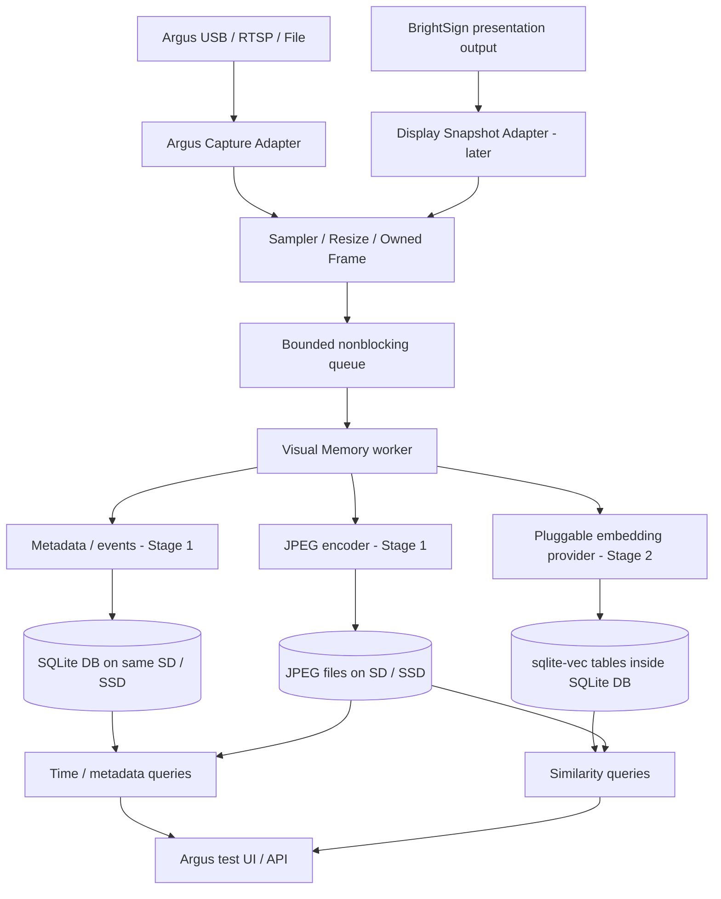
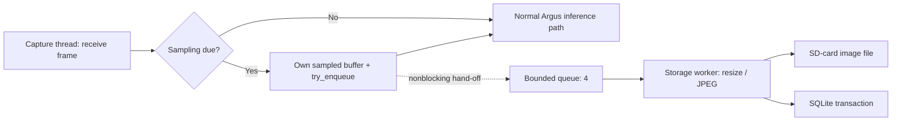

# Argus Visual Memory — Architecture, Storage and Performance Design

**Status:** Proposed design / implementation plan (not yet benchmarked)  
**Date:** 2026-11-02  
**Reference platform:** BrightSign XT5, Rockchip RK3588, existing Argus Audience Measurement extension  
**Proposed repository location:** `docs/ARGUS_VISUAL_MEMORY_DESIGN.md`  
**Scope:** Reusable C++ visual-memory library, initially integrated and tested within Argus.

> **Executive decision**
>
> Implement `libvisualmemory` as an independent C++ library, with Argus as its first frame-source adapter and integration/test harness. Stage 1 saves sampled JPEG frames and metadata to local persistent storage. Stage 2 adds embeddings and `sqlite-vec` similarity search. No new NPU model is needed in Stage 1. Use a **64 MiB incremental RAM budget** and a **4 GB local storage quota** for the initial XT5 prototype; measure actual overhead and FPS on the device.

## 1. Motivation and use cases

Argus currently provides video acquisition (USB/V4L2, RTSP/GStreamer, and file input), YOLOX/RetinaFace inference, person tracking, and analytics publication. We want to add **searchable visual history** while keeping real-time processing unaffected. Proof of play is **one application of the library**, not the library's only purpose.

| Use case | Query/example | Evidence required | Initial scope |
| --- | --- | --- | --- |
| Historical frame retrieval | “Show frames captured between 10:00 and 10:05.” | Timestamped JPEG + metadata | Stage 1 |
| Proof of play | “Was the correct advert visible at 10:00?” | **Display-output** screenshots, media events, reference assets | Application on Stage 2 (some checks possible without vectors) |
| Visual similarity search | “Find similar historical scenes or products.” | Embeddings + source image references | Stage 2 |
| Object-event search | “When did an object class appear?” | Argus detections, track metadata, timestamps | Later adapter/application |
| Historical audience analytics | “How many people were present during an advert?” | Argus aggregate events correlated to playback | Later application |
| Revisit analytics | “Did an opted-in visitor return?” | Appropriate consented identity link; not merely similar frames | Out of scope for the first PoC |

**Important limitations:** An Argus **camera frame** (USB/RTSP/file input) is not automatically a frame of the BrightSign **display output**. To verify ads played by BrightScript/HTML presentations, implement a separate screenshot/output-capture adapter and correlate it with playback events. A few matching screenshots plus application logs provide stronger evidence than schedule-only records, but do **not** prove that all video frames were displayed or that the physical screen was visible. External HDMI capture or a camera facing the display can provide a more independent evidence channel.

## 2. Design principles

1. **Reusable, vendor-agnostic core:** `libvisualmemory` should not depend on Argus internals, BrightScript, MQTT, or RKNN. Use adapters for frame capture and embedding inference.
2. **Zero storage I/O on capture/inference threads:** No `open()`, `write()`, `fsync()`, SQLite transactions, JPEG encoding, or similarity scans in the latency-critical Argus path.
3. **Bounded memory and backpressure:** Fixed-capacity queue; nonblocking `try_submit()`; count/drop samples when full; never wait for a slow SD card.
4. **Explicit frame ownership:** A `FrameView` may borrow input memory. Copy sampled pixels to owned storage or retain an explicitly safe, reference-counted buffer before its lifetime ends.
5. **Separation of physical and logical storage:** The **SD card/SSD is the storage device**. JPEG files and SQLite database files reside **on that device**. `sqlite-vec` is a SQLite extension, **not a separate storage device**.
6. **Retention and privacy by design:** Per-source sampling limits, disk quota, expiry, opt-in capture configuration; no persistent person identity matching by default.
7. **Observable costs:** Report queue depth/drops, encode/write/query latency, process RSS, Argus FPS, and disk headroom.

## 3. Architecture



The existing Argus capture/inference pipeline continues independently. Its documented capture loop calls `input_->tryFetch(...)` and fans out an owned `SharedFrame` to existing model mailboxes. Integrate an optional, low-frequency **sampling branch** without changing YOLOX, RetinaFace, ByteTrack or RF-DETR execution. Choose a safe sampling point with access to the desired scene resolution: the inference tensor may be letterboxed or reduced and unsuitable for visual evidence. Never assume its pixels equal the original camera frame.

### Suggested source layout (proposal; adapt to actual repository)

```text
argus-audience-measurement-extension/
  docs/
    ARGUS_VISUAL_MEMORY_DESIGN.md
  libs/
    visual-memory/
      CMakeLists.txt
      include/visual_memory/
        visual_memory.h
        frame.h
        config.h
        embedding_provider.h
      src/
        visual_memory.cpp
        frame_sampler.cpp
        jpeg_encoder.cpp
        sqlite_store.cpp
        retention_manager.cpp
        vector_store.cpp           # Stage 2
      tests/
  src/
    orchestration/
      orchestrator.cpp             # proposed integration point
  tests/
    visual_memory_integration/
```

Initial build output: `libvisualmemory.a`, linked into the Argus C++ extension. Keep third-party components version-pinned and cross-compiled with the existing Yocto/toolchain configuration. OpenCV/TurboJPEG already appear in Argus's documented stack; reuse safely where possible, without exposing either as a required public ABI.

### Example application-facing API (illustrative, not implemented)

```cpp
struct FrameRecord {
    std::string source_id;              // "usb0", "rtsp-1", "display-0"
    int64_t captured_utc_ms;            // wall clock, for user queries
    uint64_t frame_sequence;
    int width, height, stride;
    PixelFormat format;
    std::vector<uint8_t> owned_pixels; // or explicit shared-ownership buffer
};

class VisualMemory {
public:
    bool start(const VisualMemoryConfig& config);
    bool try_submit(FrameRecord&& frame);  // nonblocking, false if full
    std::vector<FrameInfo> query_by_time(
        int64_t from_utc_ms, int64_t to_utc_ms, size_t limit);
    std::vector<SearchResult> search_similar(
        const Embedding& query, size_t top_k);  // Stage 2
    VisualMemoryStats stats() const;
    void stop();
};
```

Use both **UTC wall-clock time** (queries and reporting) and **monotonic timestamps / source PTS** (ordering and duration). Record time-sync status/clock jumps. Restrict the size and number of returned records so a broad query cannot overwhelm the player.

## 4. Stage 1 vs Stage 2

| Dimension | Stage 1: frame persistence | Stage 2: visual memory / vector search |
| --- | --- | --- |
| Purpose | Store and retrieve sampled evidence | Search visually similar stored frames |
| Input | Argus sampled frames | Same frames + embedding provider |
| Media | JPEG files | JPEG files (shorter retention possible) |
| Database | SQLite metadata | SQLite metadata + `sqlite-vec` vector table |
| Retrieval | By time, source, frame ID, event | Plus nearest-neighbour similarity |
| AI/NPU | No additional model | Optional CPU/RKNN embedding model |
| Planned incremental RAM | **64 MiB** | **256 MiB total incremental**, model-dependent |
| Conservative incremental ceiling | 128 MiB | 512 MiB pending benchmarks |
| Local storage quota | **4 GB** | **4–5 GB**, adjust JPEG retention |
| Readiness | First implementation target | Subsequent implementation and measurement |

Stage 1 deliberately **does not compare image content**. Stage 2 adds embedding generation, vector persistence, and retrieval of top-K similar frames. Proof of play additionally needs known references and trustworthy display/playback signals; vector similarity alone is not conclusive evidence.

## 5. Storage: exactly what goes where

**Physical location:** On the XT5, use persistent storage mounted at `/storage/sd` for the PoC (verify writable mount and filesystem first). This contains **both** the JPEG image files and the SQLite database file. The image blobs are **not** duplicated inside SQLite.

```text
/storage/sd/visual-memory/
  visual_memory.db             # SQLite: metadata, events, vector rows (Stage 2)
  visual_memory.db-wal         # Only if WAL mode enabled; transient but important
  visual_memory.db-shm         # Only if WAL mode enabled
  frames/
    2026-11-02/
      10/
        usb0_20261102T100005Z_1001.jpg
        usb0_20261102T100010Z_1002.jpg
  snapshots/                   # optional later: display-output captures
  references/                  # optional later: registered ad frames/assets
```

Use time/source subdirectories to avoid one enormous directory; avoid unsanitized source IDs in paths. Prefer **relative image paths** in SQLite, validated against a configured storage root.

| Item | File/location | Purpose |
| --- | --- | --- |
| Sampled image | `frames/...jpg` | Visual inspection and reference evidence |
| Source, timestamp, width, image relative path | SQLite `frames` | Indexed lookup |
| Capture/encoder version, SHA-256, sample quality | SQLite `frames` | Provenance and integrity |
| Ad play start/end/error, asset hash | SQLite `playback_events` | Playback evidence (later adapter) |
| YOLOX object or tracked-event metadata | SQLite `detections` / `events` | Optional Argus analytics link |
| 256D / 512D numerical embedding | `sqlite-vec` table in **same** SQLite DB | Similarity search (Stage 2) |
| Embedding model ID/version/dimensions | SQLite metadata | Prevent cross-model comparisons |
| Search results | Query result, not normally another image file | Ranked frame IDs, scores, times |

Example conceptual row:

```json
{
  "frame_id": 1001,
  "captured_utc": "2026-11-02T10:00:05Z",
  "source_id": "usb0",
  "image_path": "frames/2026-11-02/10/usb0_20261102T100005Z_1001.jpg",
  "width": 640,
  "height": 360,
  "jpeg_bytes": 100000,
  "embedding_model": "visual-v1",
  "embedding_dimensions": 256
}
```

Stage 1 stores no embedding; the last two fields become meaningful only in Stage 2. Embeddings are stored as vector BLOBs/virtual-table entries, **not** as human-readable JSON arrays in production.

### Suggested SQLite schema (Stage 1)

```sql
PRAGMA foreign_keys = ON;

CREATE TABLE IF NOT EXISTS frames (
    id                 INTEGER PRIMARY KEY,
    source_id          TEXT NOT NULL,
    captured_utc_ms    INTEGER NOT NULL,
    monotonic_ns       INTEGER,
    source_pts_ns      INTEGER,
    frame_sequence     INTEGER,
    width              INTEGER NOT NULL,
    height             INTEGER NOT NULL,
    image_path         TEXT NOT NULL UNIQUE,
    jpeg_bytes         INTEGER NOT NULL,
    sha256_hex         TEXT,
    created_utc_ms     INTEGER NOT NULL
);

CREATE INDEX IF NOT EXISTS idx_frames_source_time
    ON frames(source_id, captured_utc_ms);

CREATE TABLE IF NOT EXISTS playback_events (
    id                 INTEGER PRIMARY KEY,
    player_id          TEXT,
    source_id          TEXT,
    asset_id           TEXT,
    asset_sha256_hex   TEXT,
    event_type         TEXT NOT NULL,  -- start/end/error
    event_utc_ms       INTEGER NOT NULL,
    payload_json       TEXT
);

CREATE INDEX IF NOT EXISTS idx_playback_asset_time
    ON playback_events(asset_id, event_utc_ms);
```

`playback_events` is future-facing and can remain unused in the first Argus camera demo. Create the vector table through a version-pinned `sqlite-vec` migration in Stage 2; do **not** silently mix vectors from different embedding models or dimensions.

### Safe file/row consistency

Use a single writer owner and a recoverable ingest sequence, e.g. encode JPEG to a temporary file, write/flush according to configured durability policy, atomically rename into place **on the same filesystem**, then insert its SQLite row in a transaction. A crash can still leave an orphan JPEG; recover by a bounded reconciliation/cleanup job. Do not assume a filesystem rename and SQLite commit form one atomic transaction. On deletion, remove/mark the DB row and corresponding JPEG with recoverable cleanup and log failed deletes. Never delete a frame used as retained audit evidence contrary to policy.

### SQLite journal/file-system notes

Check `df -T /storage/sd` and mount options before choosing a journal mode. `WAL` improves concurrent reads/writes but uses `visual_memory.db-wal` and `visual_memory.db-shm`, plus checkpoint/sync I/O; **do not assume WAL is automatically safe or optimal on every FAT/exFAT SD-card configuration**. Validate actual locking, crash recovery and power-loss behaviour on the deployed filesystem. Prefer a suitable Linux-native filesystem on appropriate storage for robust high-write production use when supported by the player/deployment. `synchronous=FULL` favours commit durability; `NORMAL` can lose recently committed transactions after sudden power loss in WAL mode. `journal_mode` and `synchronous` must be explicit deployment decisions after testing, not hard-coded claims.

## 6. Actual XT5 baseline (supplied device measurements)

Captured with Argus running; PID 1017 is assumed to be the relevant Argus process.

```text
MemTotal:       3743704 kB
MemAvailable:   2851004 kB      (free -m output showed ~2857340 in 'available')
Swap:           0
CmaTotal:        131072 kB
CmaFree:              0 kB

PID 1017:
VmSize:        1669632 kB
VmHWM:          694864 kB
VmRSS:          643440 kB
Threads:            15

/storage/sd:  15G total, 7.2G used, 7.7G available, 49% used
```

**Interpretation:**

| Metric | Approximate value | Notes |
| --- | ---: | --- |
| Physical RAM | **3.57 GiB** | Derived from `/proc/meminfo` kB values |
| OS-estimated available RAM | **2.72 GiB** | Includes reclaimable memory; not fully reserved capacity |
| Argus `VmRSS` | **628 MiB** | Resident memory for that process |
| Argus `VmHWM` | **679 MiB** | Historical peak RSS |
| Argus `VmSize` | **1.59 GiB** | Virtual memory; **not** current physical consumption |
| Swap | **0** | No swap fallback; bounded memory is important |
| CMA | 128 MiB total / 0 MiB free shown | Investigate if video/DMA allocations fail; not proof of normal RAM shortage |
| SD card | **15 GB**, **7.7 GB free** | Small enough that image retention is the main immediate limit |

**RAM conclusion:** Stage 1 is unlikely to be constrained by total RAM if allocations stay bounded. Stage 2 needs model-specific benchmarking for RKNN weights, tensors, temporary CPU buffers and vector index/query memory. Check concurrent workloads (presentations, models, graphics) rather than equating `MemAvailable` with guaranteed future allocation success.

## 7. RAM budgets (incremental over running Argus)

### Stage 1 target: **64 MiB additional RSS**

| Component | Budget (MiB) |
| --- | ---: |
| Four-frame queue, 640×360 NV12, plus framing | 2 |
| JPEG encoder buffers | 8 |
| SQLite cache | 8 |
| Conversions / scratch buffers | 16 |
| Worker threads, metadata, stack allowances | 8 |
| Allocator and operational headroom | 22 |
| **Total target** | **64 MiB** |

A 640×360 NV12 frame uses `640 × 360 × 1.5 = 345,600` bytes (~0.33 MiB); four such frames use ~**1.32 MiB** before alignment, conversions and queue bookkeeping. Copying the full 1080p input instead would be far more expensive. Encode in a bounded background worker; avoid holding multiple original-resolution frames or long-lived DMA buffers.

At the current Argus RSS baseline, an illustrative 64 MiB RSS increment corresponds to ~**692 MiB Argus RSS**. This is **a target, not a measurement**. Allow a 128 MiB investigation ceiling if library code or image conversion needs more headroom.

### Stage 2 target: **256 MiB total incremental RSS**, investigate up to 512 MiB

This is the **combined** Visual Memory increment including Stage 1, the embedding model/runtime buffers, SQLite vector search and query scratch memory; it is **not 256 MiB on top of Stage 1's 64 MiB**. The actual value depends on the selected model, backend, model loading strategy and vector search mode. Avoid blindly loading the entire historical vector corpus or index into RAM.

## 8. SD-card/storage budget

### Initial quota: **4 GB total**

| Stage 1 allocation | Planning budget |
| --- | ---: |
| JPEG images | **3.5 GB** |
| SQLite metadata and indices | **0.25 GB** |
| Journal, transient files, recovery margin | **0.25 GB** |
| **Total Visual Memory quota** | **4.0 GB** |

Keep a separate **minimum free-space reserve** outside this quota, and consider normal presentation/asset updates. With 7.7 GB free at baseline, a filled 4 GB Visual Memory quota would leave roughly **3.7 GB** free if no other writes occur. Enforce *both* bytes quota and retention age. Fail open for analytics (drop samples) when free space or quota is exceeded.

Assuming **100 KB = 100,000 bytes per compressed JPEG**, continuous capture 24 hours/day:

| Capture interval | Samples/day | JPEG payload/day | JPEG payload/7 days |
| --- | ---: | ---: | ---: |
| 1 second | 86,400 | 8.64 GB | 60.48 GB |
| **5 seconds** | **17,280** | **1.728 GB** | **12.096 GB** |
| 10 seconds | 8,640 | 0.864 GB | 6.048 GB |
| 30 seconds | 2,880 | 0.288 GB | 2.016 GB |

At 5 seconds and 100 KB average, **3.5 GB** of JPEG budget is enough for approximately **48.6 hours** of continuous images, before variation, metadata or overhead. Therefore **48 hours is a ceiling near the estimated capacity, not a guaranteed retention SLA**; quota eviction may occur sooner. Lower resolution/quality, sample less frequently, keep only event frames, or increase storage to extend retention. Avoid excessive write amplification from one-file-per-sample where practical and test card endurance.

### Stage 2 embedding payloads

For a **256-dimensional vector** (raw payload only, excluding SQLite metadata/index/WAL):

| Numeric format | Bytes/vector | 100,000 vectors | 30 days at one sample / 5 s |
| --- | ---: | ---: | ---: |
| FP32 | 1,024 | 102.4 MB | **530.8 MB** |
| FP16 (if supported by chosen storage path) | 512 | 51.2 MB | 265.4 MB |
| INT8 | 256 | 25.6 MB | 132.7 MB |

At one sample every five seconds, 30 days = **518,400 vectors**. For Stage 2, a **4–5 GB** overall quota can work with short JPEG retention and a dedicated vector/metadata allowance (for example ~3 GB images, ~1 GB database/index/journal), but the final values depend on index overhead and actual frame sizes. `sqlite-vec` supports float32, int8 and binary vectors; do not assume FP16 can be queried natively without explicit encoding/conversion support.

**Key insight:** Keeping vectors longer than JPEG images preserves a **similarity-searchable summary**, but the original historical image is no longer available to inspect once deleted. Search results must explicitly indicate `image_available=false` and must not masquerade as retained visual proof.

## 9. Performance design: SD I/O without slowing Argus

For 100 KB every five seconds the average JPEG payload write rate is only **20 KB/s**. That is generally low throughput; **latency spikes**, filesystem metadata updates, journal checkpointing, and contention with media playback matter more than bulk bandwidth.

### Correct thread split



**Rules:**

- Sampling check is O(1) using monotonic time / frame PTS; target one frame per five seconds (configurable).
- Never call storage syscalls from Argus's capture or model threads. If sampling requires copying, keep that copy small and measured; optionally dispatch resize to a separate worker with safely owned source data.
- Queue capacity initially **4 samples**; if full, drop newest (or choose a documented policy) and increment `samples_dropped_queue_full`.
- Keep a **single DB writer**, with prepared statements/transactions and bounded page cache; perform checkpoints/retention outside latency-critical paths.
- Keep image files outside SQLite BLOBs. Database lookups return indexed paths/metadata; image reads occur only when requested.
- Monitor rate of JPEG creation, actual JPEG sizes, disk latency (p50/p95/p99), `fsync`/transaction delays, card free space and Argus FPS.
- Prolonged disk slowdown, ENOSPC, missing/unmounted card, read-only filesystem and DB errors must **disable evidence ingestion gracefully**, not stop detection/tracking or playback.
- SD card endurance and power loss should be tested explicitly for any production evidence-retention requirement.

### SQLite vector search performance

Lightweight insertion is unlikely to dominate at 0.2 vectors/sec; query cost depends heavily on corpus size, representation, filtering and indexing. Partition/filter by source, time range and model ID before large similarity searches. Limit top-K and concurrent queries; throttle/reject expensive searches while Argus is under load. Benchmark on-device using actual `sqlite-vec` version, not theoretical calculations. Do not claim an ANN index or fixed query latency without selecting and verifying an implementation.

## 10. Proof of play application (later use of the library)

Example: a presentation should show `brand_ad_30s.mp4` at a Walmart store at **10:00**.

**Proposed evidence chain:**

1. Presentation/BrightScript/JavaScript adapter records scheduled media ID and playback **start/end/error** events; capture the registered file SHA-256 where possible.
2. An **output screenshot adapter** captures what the BrightSign presentation reports as displayed (for example at approximately 3, 15 and 27 seconds); the built-in diagnostic/snapshot mechanism is a candidate to validate on XT5 firmware and with video overlays/multi-zone layouts.
3. The shared Visual Memory library stores images, time, source and event linkage. The Stage 2 matcher compares against expected reference imagery (perceptual hashes/SSIM can be preferable for exact creative matching; general embeddings help with broader visual search).
4. A proof-of-play application combines the verified media asset, event timing and matched captured output into a confidence-scored result and an auditable record.
5. Store evidence hashes and model/algorithm versions. For real audits, sign/export evidence off-device, protect access, maintain clock-sync status, and retain failures and disputed events according to policy.

**Do not conflate these signals:**

- A playback log proves only that the software **reported** playback events.
- An Argus **USB camera/RTSP input** might depict a shopper, not the HDMI output.
- A display screenshot shows a sample of the **player's composited output**, not necessarily a physical-screen observation.
- Three matching images do **not** guarantee uninterrupted full-length playback; a hash of the source file proves asset integrity, not display delivery.
- More independent evidence may require HDMI capture hardware or a camera facing the display.

## 11. Future object search and revisit analysis

For object/scene search, add a replaceable model provider (CPU first for functional tests; RKNN NPU after benchmarking). Store model name/version, tensor preprocessing parameters, vector dimension and distance metric; never compare vectors from incompatible models. Existing Argus tracking IDs are typically **session-local** and should not be treated as persistent cross-day identifiers.

Persistent biometric recognition or visitor re-identification introduces meaningful privacy, regulatory and accuracy issues, particularly in a retail setting. It is **not** part of Stage 1 or the default Stage 2 implementation. Prefer anonymous aggregate analytics, explicit opt-in identity links when appropriate, short retention, access controls and a privacy impact assessment before any identity-related deployment.

## 12. Configuration example (proposed)

```json
{
  "visual_memory": {
    "enabled": false,
    "storage_root": "/storage/sd/visual-memory",
    "source_id": "usb0",
    "sample_interval_ms": 5000,
    "jpeg_width": 640,
    "jpeg_height": 360,
    "jpeg_quality": 80,
    "queue_capacity": 4,
    "max_storage_bytes": 4000000000,
    "min_free_space_bytes": 2000000000,
    "jpeg_retention_hours": 48,
    "sqlite_cache_mib": 8,
    "embeddings": {
      "enabled": false,
      "model_id": null,
      "dimensions": 256,
      "retention_days": 30
    }
  }
}
```

Values are *proposal*, not existing Argus configuration keys. `enabled=false` is a safe default, particularly for camera image retention. Validate config at startup; enforce policy at runtime and record rejection/error counters. Use quota and minimum-free checks before large writes. Note that `jpeg_retention_hours=48` is a **maximum age**, not a minimum guaranteed window when the byte quota is reached sooner.

## 13. Implementation roadmap and acceptance tests

### Stage 1 — frame persistence

1. Establish baseline (`free`, RSS/HWM, FPS, SD type/free space, DMA/CMA diagnostics).
2. Build `libvisualmemory` with bounded async frame queue, JPEG encoder, single SQLite writer and lifecycle/health reporting.
3. Integrate an optional Argus frame-sampling adapter at a safe pixel-buffer ownership boundary.
4. Save compressed JPEGs and indexed metadata to `/storage/sd/visual-memory/`, with safe paths and simple query API.
5. Implement quota, retention, restart recovery, unmounted/read-only/full-card handling and corrupt-row/orphan-file reconciliation.
6. Benchmark with existing Argus detectors and a representative presentation active.

**Acceptance targets (not achieved/verified yet):**

| Test | Proposed success criterion |
| --- | --- |
| Functionality | Retrieve expected JPEGs by source + UTC time interval |
| Persistence | Records survive clean application/player restart |
| Fault isolation | Disk full, unplugged/slow card, database errors do not stop Argus processing |
| Memory | **≤64 MiB** incremental steady-state/process RSS budget target |
| Performance | **≤5%** average Argus FPS reduction target, no storage wait on capture thread |
| Queue | Bounded at 4; drop counters and high-water mark observable |
| Retention | 4 GB quota + free-space floor consistently enforced |
| Consistency | Recover partial writes and identify orphan/missing evidence |

### Stage 2 — embeddings and vector similarity

1. Select an embedding model and validate on representative scenes; begin with CPU functional correctness, then profile RKNN on XT5.
2. Add model-versioned vector schema and `sqlite-vec` backend, pinned to a tested release.
3. Implement reference-image embedding, top-K similarity, score calibration and time/source filters.
4. Benchmark model inference latency, NPU utilisation, p95/p99 query latency, memory RSS/HWM, SQLite file growth and concurrent FPS.
5. Set independent retention for JPEGs and embeddings; expose whether original images remain available.
6. Add first application: visual content match + proof-of-play evidence with a separate presentation-output adapter.

**Acceptance targets:** total incremental Visual Memory RSS initially **≤256 MiB** (investigate up to **512 MiB**), controlled search concurrency, no blocking on the capture thread. Model accuracy/confidence thresholds must be established with a measured validation set.

## 14. On-device measurement commands

```sh
# Verify actual filesystem and mount options; do NOT reformat a player card casually.
df -hT /storage/sd
mount | grep /storage/sd

# System RAM: units from /proc/meminfo are kB.
free -h
grep -E 'MemTotal|MemAvailable|CmaTotal|CmaFree' /proc/meminfo

# Argus PID: replace 1017 if changed.
cat /proc/1017/status | grep -E 'VmRSS|VmHWM|VmSize|Threads'

# Database/image growth.
du -sh /storage/sd/visual-memory 2>/dev/null
find /storage/sd/visual-memory/frames -type f -name '*.jpg' 2>/dev/null | wc -l

# OOM, CMA/DMA failures or I/O errors (if accessible).
dmesg | grep -Ei 'cma|oom|out.of.memory|allocation failure|mmc|I/O error' | tail -n 50
```

Benchmark **baseline Argus**, **Stage 1 enabled**, and **Stage 2 enabled** using the same input and duration. Capture start/end disk usage, process RSS/HWM, average/1% low FPS, CPU/NPU load, dropped input and sample frames, JPEG encode p95/p99, SD write p95/p99, SQLite transaction p95/p99, and vector search latency. Test storage contention when playing media from the **same SD card**.

## 15. Risks and decisions still open

| Risk / decision | Proposed mitigation |
| --- | --- |
| Actual SD filesystem is unknown | Run `df -hT` and `mount`, then validate SQLite journal/locking and power recovery |
| `CmaFree=0` | Monitor for actual DMA allocation errors; use ordinary owned CPU buffers and avoid extra long-lived DMA allocations |
| Input frame lifetime/letterbox | Integrate using safe ownership and original-resolution or suitably resized scene frames |
| JPEG payload may exceed 100 KB | Measure real distribution and enforce size/quota limits |
| SD wear, power loss, WAL/checkpoint spikes | Async I/O, bounded transactions, durability tests; SSD for higher-write production cases |
| SQLite/vector query load | Limits on query period/top-K/concurrency, time/model filtering, explicit benchmark |
| Lack of independent proof of display | Presentation output snapshots + playback logs; external capture where contractual assurance requires it |
| Privacy/camera image retention | Disabled by default, strict retention, access control and non-biometric-first design |
| Extension packaging | Validate static library/SQLite extension licensing, toolchain, symbol export and platform compatibility |

## 16. Summary / engineering decision record

- **Build:** A reusable C++ `libvisualmemory`, first integrated into the existing Argus C++ repo.
- **Stage 1:** Sample a frame every five seconds, compress to JPEG, store JPEG files and time/source metadata in SQLite on `/storage/sd`, query by timestamp. **No NPU embeddings yet**.
- **Stage 2:** Add model-versioned embeddings and `sqlite-vec` inside the **same SQLite database file**, plus search by reference image and historical similarity.
- **RAM:** XT5 currently reports ~**2.72 GiB MemAvailable** with ~**628 MiB Argus RSS**. Budget **64 MiB** extra Stage 1 and **256 MiB total** extra Stage 2 (model-dependent).
- **SD:** Current SD card ~**15 GB total, 7.7 GB free**. Start with a **4 GB application quota** and ~**48-hour maximum JPEG retention**, subject to quota-driven earlier eviction. Longer vector retention is feasible because vectors are much smaller than JPEGs.
- **Performance:** ~**20 KB/s average JPEG payload write** at the example sampling rate; the main danger is write-latency spikes, JPEG/resize cost and concurrent playback contention. Use **nonblocking bounded queues, background workers, single SQLite writer** and retention cleanup.
- **Proof of play:** One downstream application. Proper display verification needs a **display-output capture adapter** and playback event/asset evidence, not only Argus camera frames or vectors.
- **Next action:** Implement the Stage 1 library and Argus adapter; run storage filesystem and power-failure checks; gather real RAM/FPS/I/O numbers on XT5 before committing to Stage 2 resource budgets.

## References

- [Argus Audience Measurement extension (BrightSign)](https://github.com/brightsign/argus-audience-measurement-extension)
- [Argus documented C++ architecture / capture-loop and frame ownership](https://github.com/brightsign/argus-audience-measurement-extension/blob/main/docs/cpp-design.md)
- [`sqlite-vec` project and supported vector types](https://github.com/asg017/sqlite-vec)
- [SQLite write-ahead logging, checkpoints and durability](https://www.sqlite.org/wal.html)
- [SQLite filesystem locking caveats](https://www.sqlite.org/howtocorrupt.html)
- [BrightSign Diagnostic Web Server screenshots](https://docs.brightsign.biz/manage/diagnostic-web-server-dws)
- [BrightSign remote snapshot REST endpoint](https://docs.brightsign.biz/develop/rdws-other-endpoints)

*All resource budgets and performance targets in this document are engineering estimates until measured on the deployed XT5 hardware. The RAM/SD snapshot is device-specific.*

---

## 17. Stage 2 as implemented and measured (XT5 / RK3588, BrightSignOS 9.1.139)

Implementation: `libs/visual-memory` (see its `README.md`, `STAGE2_RESULTS.md`, `BACKLOG.md`, `models/README.md`).
Stage 2 is optional and **disabled by default** (`visual_memory.enabled=false`, `vector_search_enabled=false`,
`embedding.enabled=false` in the committed `configs/config.json`; compile-time `-DENABLE_VISUAL_EMBEDDINGS=ON` is also required).

**Design as built.** Stage 1 worker inserts the frame row, then enqueues `(id, path, time, source)` (no pixels) to a separate
bounded Stage 2 queue. One embedding worker reads the JPEG, decodes, applies preprocessing `pp1`, runs MobileNetV2 (FP16, RKNN C API,
loaded once, serialised), L2-normalises/validates and writes the vector plus a status row in one SQLite transaction (sqlite-vec `vec0`,
FP32, one table per model identity). Search runs on the caller's thread over the same connection. JPEG and embedding retention are
independent: an expired JPEG keeps its row (`image_available=0`) while a vector exists.

**Measured (3 alternating 10-minute pairs, same camera and detectors, 5 s cadence):**

| | Stage 1 | Stage 1 + 2 | delta |
|---|---|---|---|
| FPS | 29.05 | 29.04 | none |
| RSS mean / peak | 69.5 / 73.3 MiB | 86.6 / 90.4 MiB | **+17.1 MiB** (target ≤ 256) |
| CPU mean (100 % = 1 core) | 48.6 % | 50.9 % | +2.3 pp (≈ +0.3 % of the 8-core SoC) |
| NPU core 0 mean | 79.5 % | 79.2 % | none (cores 1–2 idle) |

* FP16 vs ONNX FP32 on device (101 images): cosine mean 0.99999 (min 0.99993), top-5 overlap 0.998, top-1 1.00.
* NPU inference p50/p99 5.9/5.9 ms idle (6.3/≈7 ms live); preprocessing 10.9 ms idle (p95 ≈ 52 ms under load); JPEG decode 1.6 ms.
* Storage: ≈ 27 kB per 480x360 JPEG, ≈ 5.1 kB per 1280-d FP32 vector (+ vec0 chunk overhead; 5.6 kB/vector total in the DB).
* Exact search, on the device SD card: 100 → 0.74 ms, 1,000 → 5.1 ms, 10,000 → 41 ms (p99 67 ms), ≈ 4 µs/vector. **Not ANN.**
  Time/source filters do not reduce the scan (metadata is evaluated per row). 120k vectors ≈ 0.5 s per query.
* Capture thread never blocked: Stage 2 queue max depth 1, 0 drops, hook sample p99 < 1 ms with Stage 2 on or off.
* Vector insert on SD: p50 25–28 ms, p99 ≈ 0.95 s (worker thread only; Stage 1 DB writes show the same commit tail).

**Config in effect on a player.** Argus reads `/storage/sd/configs/argus-config.json` first; `config.json` is used only if that file is
missing (see `docs/CONFIGURATION.md`). On the test XT5 the effective file is `argus-config.json` (Visual Memory currently `enabled:false`);
the `config.json` beside it (`enabled:true`) is shadowed and has no effect.

**Open items:** `libs/visual-memory/BACKLOG.md` (VM-1 … VM-8). Proof-of-play is out of scope for Stage 2.
