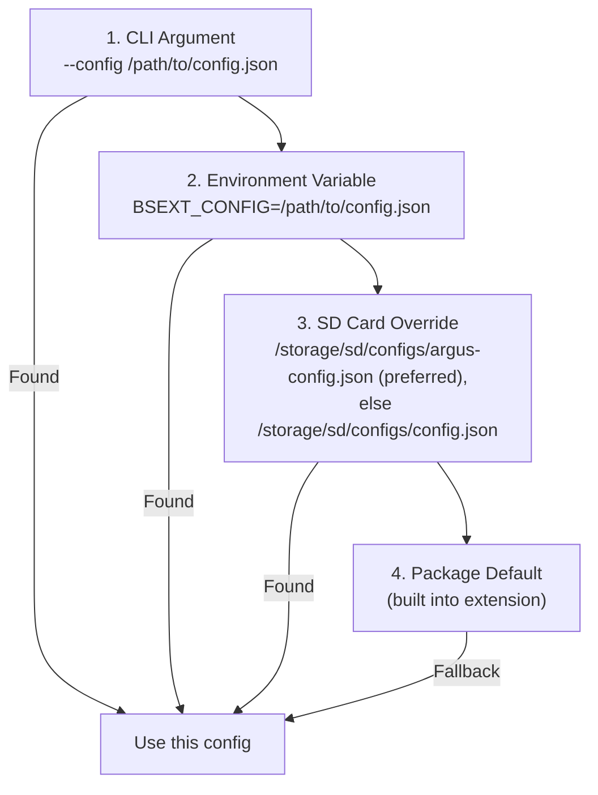

# Configuration Reference

Complete reference for configuring the Argus Audience Measurement Extension.

## Configuration File Location

Argus looks for configuration in the following order (first found wins):



**Recommended:** Use `/storage/sd/configs/argus-config.json` for customization.

> **Both SD files can exist, but only one is used.** `argus-config.json` is checked first (`src/util/util.cpp`
> `pick_config_path`, mirrored by `bsext_init`); `config.json` is read only when `argus-config.json` is absent.
> Editing the shadowed file has no effect. Package defaults (`<extension>/configs/argus-config.json`, then
> `config.json`) apply only when neither SD file exists.

## Quick Configuration

### Minimal Configuration

```json
{
  "input_source": "rtsp",
  "input": {
    "rtsp_url": "rtsp://192.168.0.100:8554/live"
  }
}
```

### Production Configuration

```json
{
  "input_source": "rtsp",
  "input": {
    "rtsp_url": "rtsp://192.168.0.100:8554/live"
  },
  "log_level": "warn",
  "publishers": [
    {
      "kind": "mqtt",
      "mqtt": {
        "host": "localhost",
        "port": 1883,
        "topic": "bs/argus/analytics",
        "period_ms": 1000
      }
    }
  ]
}
```

---

## Complete Configuration Schema

### Input Source Selection

| Key | Type | Default | Description |
|-----|------|---------|-------------|
| `input_source` | string | `"rtsp"` | Input type: `"rtsp"`, `"usb"`, or `"file"` |
| `device_id` | string | `""` | Device identifier for MQTT messages. Empty = auto-detect from MAC |

```json
{
  "input_source": "rtsp",
  "device_id": "lobby-display-01"
}
```

---

### Input Configuration

#### RTSP Camera

```json
{
  "input_source": "rtsp",
  "input": {
    "rtsp_url": "rtsp://192.168.0.100:8554/live",
    "rtsp": {
      "latency_ms": 100
    }
  }
}
```

| Key | Type | Default | Description |
|-----|------|---------|-------------|
| `input.rtsp_url` | string | Required | RTSP stream URL |
| `input.rtsp.latency_ms` | integer | `100` | Buffering latency in milliseconds |

#### USB Camera

```json
{
  "input_source": "usb",
  "input": {
    "usb_device": "/dev/video0",
    "usb": {
      "width": 640,
      "height": 480,
      "fps": 30
    }
  }
}
```

| Key | Type | Default | Description |
|-----|------|---------|-------------|
| `input.usb_device` | string | `"/dev/video0"` | USB camera device path |
| `input.usb.width` | integer | `640` | Capture width |
| `input.usb.height` | integer | `480` | Capture height |
| `input.usb.fps` | integer | `30` | Target frame rate |
| `input.usb.exposure_auto_priority` | `0` / `1` / unset | unset | Optional V4L2 `exposure_auto_priority` control (USB cameras only). `0` keeps the frame rate constant in dim light; `1` lets the camera lower its frame rate to lengthen exposure. Unset (default) leaves the camera exactly as found. Invalid values are ignored with a warning; cameras without the control are left unchanged (logged). Not applied to RTSP or file inputs. The setting is re-applied at every start (a UVC camera resets it on power-up). With `log_level: "info"` the log shows `requested`, `previous` and `actual` values plus the measured camera delivery rate (a WARN is logged when delivery falls below 80 % of the negotiated rate). |
| `visual_memory.embedding.backfill_on_startup` | bool | `false` | Embed already-stored JPEGs that have no vector, newest first, in small batches while the embedder is idle. **Bounded**: see the next two keys. Leave `false` unless you want old frames searchable; frames stored while embeddings are enabled are always embedded. |
| `visual_memory.embedding.backfill_max_frames` | int | `500` | Most frames the startup backfill attempts per Argus run (`0` = unlimited, an explicit opt-in). Reached cap: the dashboard shows the backfill as done. |
| `visual_memory.embedding.backfill_max_age_hours` | int | `24` | Only frames captured within this many hours are backfilled (`0` = no age limit). |
| `visual_memory.objects.enabled` | bool | `false` | D4 Object Search (read by `vm_api_server`, not by the Argus capture process). Enables the `/api/vm/objects*` endpoints and the dashboard's "Select Object"/"Object search" UI. Needs Stage 2 embeddings. Object regions are stored in `<storage_root>/objects.db` (separate file; `visual_memory.db` is untouched). |
| `visual_memory.objects.max_regions` | int | `10000` | Cap on indexed regions; the oldest-indexed regions beyond it are deleted when a new one is added. Independent of the frame JPEG quota and retention. |
| `visual_memory.objects.retention_days` | int | `30` | Regions indexed longer ago than this are deleted (retention follows when a region was indexed, not the parent frame's capture time). `0` = keep. |
| `visual_memory.objects.min_roi_px` | int | `16` | Smallest accepted selection side, in stored-image pixels (8..256). |
| `visual_memory.pop.enabled` | bool | `false` | D5 Proof of Play (read by `vm_api_server`, not by the Argus capture process). Starts the playback-event adapter and enables `/api/pop/*` and the dashboard's Proof of Play page. Needs `visual_memory.enabled` and Stage 2 embeddings (the MobileNetV2 model embeds display screenshots). Data is stored in `<storage_root>/pop.db` and `<storage_root>/pop/` (separate from `visual_memory.db`). Needs a player application that writes playback events and screenshots (`scripts/pop/pop_autorun.brs`). |
| `visual_memory.pop.events_path` | string | `/storage/sd/pop/events.jsonl` | JSON-lines file the player application appends playback events to; the adapter tails it (offset persisted in `<storage_root>/pop/adapter_state.json`). |
| `visual_memory.pop.jobs_dir` | string | `/storage/sd/pop/jobs` | Directory the scheduler writes play jobs into for the player application. |
| `visual_memory.pop.source_id` | string | `main_display` | Source name of the display-capture evidence (also the directory name in `pop/evidence/YYYY/MM/DD/HH/<source>/`). |
| `visual_memory.pop.poll_ms` | int | `200` | Event file poll period (50..5000). It bounds the wall-clock accuracy of event times. |
| `visual_memory.pop.capture_backend` | string | `brightscript_screenshot` | Where Proof of Play evidence frames come from: `brightscript_screenshot` (the player application's `Screenshot()`) or `resilience_grpc` (OS rendered frames; needs `visual_memory.display.enabled`, an OS image with the rendered-frame producer, and display-geometry reference frames). Can also be chosen per session with `capture_backend` in `POST /api/pop/sessions`. See `RESILIENCE_DISPLAY_FRAMES.md`. |
| `visual_memory.pop.grpc_window_before_ms` / `grpc_window_after_ms` | int | `300` / `800` | `resilience_grpc` only: a frame is used for a capture offset only if it was received within this window around the target time. |
| `visual_memory.pop.grpc_max_uncertainty_ms` | int | `1500` | `resilience_grpc` only: evidence whose time uncertainty (RPC span + producer latency budget) exceeds this is recorded as a failed capture. |
| `visual_memory.display.enabled` | bool | `false` | Display-output preview: read by `vm_api_server`. Adds `/api/display/*` and the dashboard's "Display output" panel (audience view). Polls the OS service only while a viewer or a Proof of Play session needs frames. OS-image dependent. |
| `visual_memory.display.manage_bridge` | bool | `true` | `vm_api_server` starts and supervises `argus_display_bridge` (the only gRPC component). `false` = you run it yourself. |
| `visual_memory.display.bridge_binary` / `bridge_socket` | string | `<extension>/argus_display_bridge` / `/tmp/argus_display_bridge.sock` | The bridge executable and the local socket between it and `vm_api_server`. |
| `visual_memory.display.os_socket` / `interest_file` | string | `unix:///run/brightsign/resilience/runtime_api.sock` / `/run/brightsign/resilience/rendered_frame.interest` | The OS `RenderedOutputService` socket and the producer interest sentinel. |
| `visual_memory.display.poll_ms` / `max_age_ms` / `ring_frames` | int | `200` / `1200` / `16` | Poll period while active (50..2000, the OS producer runs at 5 FPS), age beyond which a frame is not served as current, and the in-memory ring size (2..64). |
| `visual_memory.display.producer_latency_ms` | int | `250` | Budget added to a frame's time uncertainty for the OS capture/encode/notify path. **Not measured yet**; replace with a measured value after a hardware run. |
| `visual_memory.pop.evidence_max_bytes` | int | `536870912` | Cap on retained screenshot bytes; the oldest screenshots are deleted first. Rows, embeddings and scores stay. Independent of the Visual Memory frame quota. |
| `visual_memory.pop.evidence_retention_days` | int | `30` | Screenshots older than this are deleted (`0` = keep). |
| `visual_memory.pop.allow_test_jobs` | bool | `false` | Lets `POST /api/pop/sessions` play a media other than the expected one, interrupt early or break screenshots (used for the wrong-ad / interrupted / missing-evidence scenarios). Leave off in production. |
| `visual_memory.pop.thresholds.*` | float | `match_sim 0.80`, `reject_sim 0.60`, `margin 0.05`, `min_play_ratio 0.90`, `min_match_fraction 0.60` | Verification decision thresholds (see `docs/VISUAL_MEMORY_PROOF_OF_PLAY.md`). Calibrated on the XT5 with two advertisements; recalibrate for new content.

#### Video File (Testing)

```json
{
  "input_source": "file",
  "input": {
    "file_path": "/storage/sd/test-video.mp4",
    "file": {
      "loop": true
    }
  }
}
```

| Key | Type | Default | Description |
|-----|------|---------|-------------|
| `input.file_path` | string | Required | Path to video file |
| `input.file.loop` | boolean | `false` | Loop video playback |

---

### Model Configuration

#### Primary Model (RetinaFace)

```json
{
  "primary_model": {
    "name": "retinaface",
    "model_path": "model/retinaface.rknn",
    "input_size": [320, 320],
    "npu_core": 0,
    "conf_threshold": 0.3,
    "nms_threshold": 0.45,
    "norm": {
      "mean": [123.675, 116.28, 103.53],
      "std": [58.395, 57.12, 57.375]
    }
  }
}
```

| Key | Type | Default | Description |
|-----|------|---------|-------------|
| `name` | string | `"retinaface"` | Model identifier |
| `model_path` | string | Required | Path to .rknn model file |
| `input_size` | [int, int] | `[320, 320]` | Model input dimensions |
| `npu_core` | integer | `0` | NPU core to use (0-2) |
| `conf_threshold` | float | `0.3` | Minimum confidence to detect |
| `nms_threshold` | float | `0.45` | Non-max suppression threshold |

#### Secondary Models (YOLOX)

```json
{
  "secondary_models": [
    {
      "name": "yolox",
      "model_path": "model/yolox_s.rknn",
      "input_size": [640, 640],
      "npu_core": 1,
      "conf_threshold": 0.5,
      "nms_threshold": 0.45,
      "norm": {
        "mean": [0, 0, 0],
        "std": [1, 1, 1]
      }
    }
  ]
}
```

---

### Publisher Configuration

#### MQTT Publisher

```json
{
  "publishers": [
    {
      "kind": "mqtt",
      "mqtt": {
        "host": "localhost",
        "port": 1883,
        "topic": "bs/argus/analytics",
        "qos": 0,
        "retain": false,
        "period_ms": 1000
      }
    }
  ]
}
```

| Key | Type | Default | Description |
|-----|------|---------|-------------|
| `mqtt.host` | string | `"localhost"` | MQTT broker hostname |
| `mqtt.port` | integer | `1883` | MQTT broker port |
| `mqtt.topic` | string | `"bs/argus/analytics"` | Topic to publish to |
| `mqtt.qos` | integer | `0` | MQTT QoS level (0, 1, or 2) |
| `mqtt.retain` | boolean | `false` | Retain messages on broker |
| `mqtt.period_ms` | integer | `1000` | Publish interval in milliseconds |

---

### Runtime Settings

```json
{
  "runtime": {
    "target_fps": 30,
    "heartbeat_ms": 1000
  }
}
```

| Key | Type | Default | Description |
|-----|------|---------|-------------|
| `target_fps` | integer | `30` | Target processing frame rate |
| `heartbeat_ms` | integer | `1000` | Health check interval |

---

### Processing Settings

```json
{
  "processing": {
    "th": {
      "score": 0.5,
      "iou": 0.45
    },
    "nms_max_dets": 100
  }
}
```

| Key | Type | Default | Description |
|-----|------|---------|-------------|
| `processing.th.score` | float | `0.5` | Detection score threshold |
| `processing.th.iou` | float | `0.45` | IoU threshold for NMS |
| `processing.nms_max_dets` | integer | `100` | Maximum detections after NMS |

---

### Logging

```json
{
  "log_level": "info",
  "log_dir": "/storage/sd/logs",
  "log_json": true
}
```

| Key | Type | Default | Description |
|-----|------|---------|-------------|
| `log_level` | string | `"info"` | Log verbosity (see below) |
| `log_dir` | string | `"/storage/sd/logs"` | Log file directory |
| `log_json` | boolean | `true` | Output logs in JSON format |

#### Log Levels

| Level | Description |
|-------|-------------|
| `debug` | All messages including debug output |
| `info` | Informational messages and above (recommended) |
| `warn` | Warnings and errors only (production) |
| `error` | Errors and critical only |

---

### Privacy Features

```json
{
  "blur_faces": true,
  "blur_method": "pixelate",
  "blur_intensity": 12
}
```

| Key | Type | Default | Description |
|-----|------|---------|-------------|
| `blur_faces` | boolean | `false` | Enable person blurring in output frames (blurs the full person bounding box, not just the face region) |
| `blur_method` | string | `"pixelate"` | Blur method: `"pixelate"` or `"gaussian"` |
| `blur_intensity` | integer | `12` | Blur strength (see below) |

#### Blur Intensity

| Method | Intensity | Description |
|--------|-----------|-------------|
| `pixelate` | 4-32 | Block size in pixels. Smaller = more detail visible |
| `gaussian` | 31-99 | Kernel size (must be odd). Larger = more blur |

**Note:** Blurring only affects output frames written to `output_dir`, not analytics data.

---

### Frame Output (Debug)

```json
{
  "enable_frame_output": true,
  "output_dir": "/tmp"
}
```

| Key | Type | Default | Description |
|-----|------|---------|-------------|
| `enable_frame_output` | boolean | `false` | Write annotated frames to disk |
| `output_dir` | string | `"/tmp"` | Directory for output frames |

---

### Test Modes

```json
{
  "test_face_only": false,
  "test_yolo_only": false
}
```

| Key | Type | Default | Description |
|-----|------|---------|-------------|
| `test_face_only` | boolean | `false` | Run only RetinaFace (disable YOLOX) |
| `test_yolo_only` | boolean | `false` | Run only YOLOX (disable RetinaFace) |

Use these for debugging or on single-core NPU devices.

---

## BrightSign Registry Configuration

Some settings can be overridden via BrightSign registry:

```bash
# Set video device via registry
registry write extension bsext-gaze-video-device rtsp://192.168.0.100:8554/live

# Disable auto-start
registry write extension bsext-gaze-disable-auto-start true
```

### Registry Keys

| Key | Type | Description |
|-----|------|-------------|
| `bsext-gaze-video-device` | string | Override input source |
| `bsext-gaze-disable-auto-start` | boolean | Disable automatic startup |

### Priority Order

Set `input_source_priority` to control which takes precedence:

```json
{
  "input_source_priority": "config"
}
```

| Value | Behavior |
|-------|----------|
| `"config"` | Use config.json settings (default) |
| `"registry"` | Use BrightSign registry values |

---

## Example Configurations

### High-Traffic Retail (RTSP, High FPS)

```json
{
  "input_source": "rtsp",
  "input": {
    "rtsp_url": "rtsp://192.168.0.100:8554/live",
    "rtsp": { "latency_ms": 50 }
  },
  "log_level": "warn",
  "runtime": { "target_fps": 30 },
  "publishers": [{
    "kind": "mqtt",
    "mqtt": {
      "host": "localhost",
      "port": 1883,
      "topic": "bs/argus/analytics",
      "period_ms": 500
    }
  }]
}
```

### Low-Power Kiosk (USB, Single Model)

```json
{
  "input_source": "usb",
  "input": {
    "usb_device": "/dev/video0",
    "usb": { "width": 640, "height": 480, "fps": 15 }
  },
  "log_level": "warn",
  "test_face_only": true,
  "runtime": { "target_fps": 15 }
}
```

### Development/Testing (File, Debug)

```json
{
  "input_source": "file",
  "input": {
    "file_path": "/storage/sd/test-video.mp4",
    "file": { "loop": true }
  },
  "log_level": "debug",
  "enable_frame_output": true,
  "output_dir": "/tmp"
}
```

### Privacy Mode (Face Blurring)

```json
{
  "input_source": "rtsp",
  "input": { "rtsp_url": "rtsp://192.168.0.100:8554/live" },
  "blur_faces": true,
  "blur_method": "pixelate",
  "blur_intensity": 16,
  "enable_frame_output": true,
  "output_dir": "/storage/sd/frames"
}
```

---

## Validation

### Check Configuration Syntax

```bash
# Validate JSON syntax
cat /storage/sd/configs/config.json | python3 -m json.tool
```

### Test Configuration

```bash
# Start with specific config
cd /var/volatile/bsext/ext_npu_argus
./attention_demo --config /storage/sd/configs/config.json
```

### View Active Configuration

Check the logs to see which configuration was loaded:

```bash
tail -100 /tmp/ext-npu-argus.log | grep "Config path"
```

---

## Related Documentation

- **[MQTT Integration](INTEGRATION-MQTT.md)** - Configure MQTT output
- **[Prometheus Integration](INTEGRATION-PROMETHEUS.md)** - Metrics configuration
- **[Build Instructions](BUILD-INSTRUCTIONS.md)** - Building from source
- **[README](../README.md)** - Project overview
