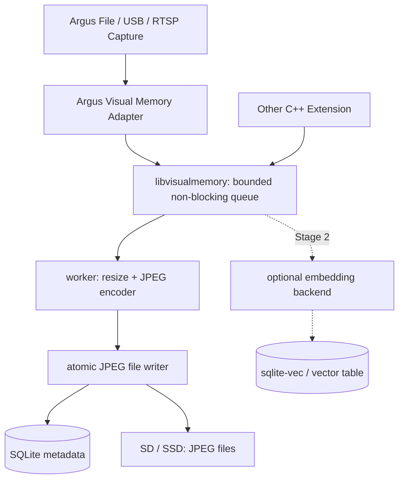

# Copilot Implementation Brief: Reusable `libvisualmemory` for BrightSign Argus

**Status:** implementation specification, not an implementation  
**Primary target:** BrightSign XT5 / RK3588 (BrightSign OS)  
**Development host:** Linux x86_64, with Argus's existing container/cross-compilation workflow  
**Initial integration:** `brightsign/argus-audience-measurement-extension`  
**Design principle:** the library must remain independent of Argus and usable by other C++ extensions.

> **COPILOT: READ THIS ENTIRE DOCUMENT FIRST.** Work in the locally cloned repository. Inspect the *actual current checkout* before editing; filenames and implementation details may differ from upstream documentation. Implement the milestones in sequence, run available tests, and report the exact changes and actual verification results. Do not declare unexecuted tests successful. Do not refactor unrelated Argus code.

---

## 0. Objective and boundaries

Build a reusable C++20 library named `libvisualmemory` that:

1. Receives frames and metadata through a clean public API.
2. Asynchronously samples/ingests and saves JPEGs to persistent storage.
3. Persists timestamps, source identifiers, image paths and other metadata in **SQLite**.
4. Allows queries by source and time interval, retrieval of image paths, retention cleanup and disk quotas.
5. Has **optional** interfaces for future image embeddings and vector similarity (`sqlite-vec`, RKNN/ONNX), without requiring these for Stage 1.
6. Is integrated into Argus through a **thin adapter** using existing file/USB/RTSP frame input, without altering its detection/tracking logic.
7. Can be compiled and tested independently on a standard Linux machine, and then linked/packaged into Argus for XT5.

**Out of scope for Stage 1:** training models, NPU inference, face recognition, persistent person identification, matching returning visitors, RTSP decoding *within the library*, player-output capture, a web UI, and claims of proof-of-play verification. USB/RTSP frames captured by Argus are **not** automatically the BrightSign video output. A future playback-output/screenshot adapter is a separate integration.

**Do not make the library depend on:** `Orchestrator`, Argus `FrameView`/`SharedFrame`, Argus logging macros, BrightScript, BrightSign APIs, MQTT, YOLOX, RetinaFace, ByteTrack, RKNN, GStreamer or platform-specific camera classes. Those belong in adapters/optional backends.

**Preserve existing Argus behaviour when disabled.** Runtime frame storage must be **OFF by default** because the current audience-measurement product deliberately avoids image retention. Do not add automatic face identification, cross-day identity matching or network upload of stored frames.

---

## 1. First inspect the checked-out repository (mandatory)

Before making changes:

- Inspect `README.md`, `docs/cpp-design.md`, `CMakeLists.txt`, `Makefile`, `package`, `tests/`, `configs/`, and relevant configuration loaders.
- Inspect `include/input/input_source.h`, `include/pipeline/shared_frame.h`, `src/orchestration/orchestrator.cpp`, `src/main.cpp`, and actual frame conversion/ownership paths.
- Identify the precise capture point that preserves the **source scene**; model-preprocessed frames may be resized or letterboxed, which is unacceptable if we intend to store faithful source images.
- Examine current `CMake` test/build conventions and target dependencies (project uses C++20; verify locally). Determine whether SQLite3 and TurboJPEG are present in the host and target SDK/sysroot. Reuse a supported encoder already in the repository when practical; avoid introducing a new heavyweight dependency.
- Confirm which storage paths are writable and persistent on the deployed player; `/usr/local/argus` in development builds may be volatile.
- Inspect whether project documentation is stale. **Source code in the checkout is authoritative.**
- Make a short list of files to modify and the proposed integration hook before editing.

Do not assume an SDK library is present merely because it exists on the development host. Do not download floating dependencies or change existing cross-compilation flags globally.

## 2. Required architecture



- **Argus adapter:** decides which source frame is sampled; performs only the unavoidable safe ownership/copy on the capture path. No filesystem I/O, JPEG compression, SQL or NPU work on the capture thread.
- **Core library:** queue, worker, encoder abstraction, file store, database store, retention, time queries, metrics.
- **Optional Stage 2 modules:** feature extraction, vector index/search, model metadata. No RKNN dependency in core.
- **Storage:** SQLite DB and compressed JPEG files both reside on the same physical SD card/SSD; vector data is stored inside the DB, while images are individual files.

### Proposed source layout (adapt to existing conventions)

```text
libs/visual-memory/
  CMakeLists.txt
  README.md
  include/visualmemory/
    visual_memory.h
    types.h
    embedding_provider.h        # Stage 2 API only
  src/
    visual_memory.cpp
    frame_encoder.cpp
    sqlite_store.cpp
    file_store.cpp
    retention.cpp
    # vector_store.cpp      # Stage 2 implementation
  tests/
    test_visual_memory.cpp
    test_sqlite_store.cpp
    test_retention.cpp
  examples/
    ingest_image.cpp

src/integrations/visual_memory_argus_adapter.cpp  # exact location may vary
include/integrations/visual_memory_argus_adapter.h
configs/config.json
CMakeLists.txt
```

Do not include Argus headers anywhere under `libs/visual-memory/`. The example and tests must work with no Argus, camera, RKNN SDK, NPU or BrightSign OS present.

## 3. Stage 1 — implement real JPEG + SQLite persistence (first deliverable)

### 3.1 API contract

Create an ergonomic C++20 public API. The following is illustrative (refine names if needed but preserve semantics):

```cpp
namespace visualmemory {

enum class PixelFormat { RGB24, BGR24, NV12, JPEG };

struct FrameMetadata {
    std::string source_id;       // e.g. "/dev/video1", "rtsp-camera-1", "file:test.mp4"
    std::string source_type;     // usb / rtsp / file / presentation
    std::string device_id;
    int64_t capture_utc_ms = 0;  // wall clock for historical queries
    int64_t pts_ns = 0;          // media timestamp where available
    uint64_t source_sequence = 0;
};

struct OwnedFrame {
    int width = 0;
    int height = 0;
    PixelFormat pixel_format = PixelFormat::RGB24;
    int stride0 = 0;
    int stride1 = 0;
    std::vector<uint8_t> pixels;  // owned, no borrowed pointers after submission
    FrameMetadata metadata;
};

struct Config {
    std::string root_directory;
    int64_t sample_interval_ms = 5000;
    int stored_width = 640;
    int stored_height = 360;
    int jpeg_quality = 75;
    size_t max_pending_frames = 4;
    uint64_t max_storage_bytes = 4ULL * 1000 * 1000 * 1000; // 4 GB planning quota
    int retention_hours = 48;
};

struct FrameInfo {
    int64_t id;
    FrameMetadata metadata;
    int width, height;
    std::string relative_jpeg_path;
    uint64_t file_size_bytes;
    std::string sha256_hex;
};

struct Stats {
    uint64_t samples_seen, accepted, dropped_queue_full;
    uint64_t jpeg_write_failures, database_failures;
    uint64_t bytes_on_disk;
    size_t queue_depth;
};

class VisualMemory {
public:
    explicit VisualMemory(Config cfg);
    bool start();
    bool try_submit(OwnedFrame&& frame);  // NEVER waits on storage or database I/O
    std::vector<FrameInfo> query_by_time(
        int64_t start_utc_ms, int64_t end_utc_ms,
        const std::string& source_id = {});
    Stats stats() const;
    void stop();
};

} // namespace visualmemory
```

**API design notes:**

- `try_submit` must be non-blocking relative to database/IO; it may briefly use a mutex to move an **already-owned** frame into the bounded queue. Return `false` if stopped/full/invalid.
- Ensure actual frame ownership and lifetime across the worker thread. **Never queue Argus `FrameView` raw pointers** to short-lived capture buffers.
- Allocate and resize carefully: if the only safe frame available is full-resolution, a bounded copy may be necessary on sampled frames. Measure its capture-thread cost.
- Avoid a fresh full-size allocation on every 30-FPS frame. Sampling decision must happen before copying. Prefer preallocated/reused buffers where practical.
- Support the specific pixel formats that are actually tested; fail clearly on unsupported formats. Validate byte length, plane strides, integer overflow, dimensions, timestamps and paths.
- Use `std::chrono::steady_clock` to schedule sampling; store `system_clock` UTC epoch milliseconds separately. Source PTS is additional metadata, **not** equivalent to UTC. For accelerated video-file playback, document how sampling follows real time vs media time; make deterministic file tests possible.
- Support future multi-source use by keeping sampler state per source ID (or clearly state Stage 1 supports one stream only).
- A failed library or full card must degrade only Visual Memory; Argus inference must continue.

### 3.2 JPEG generation

- Preserve the *scene* aspect ratio. Output target: fit inside **640×360** (or configured bounds), letterbox only if necessary, with correct orientation/colour conversion; never stretch without an explicit choice.
- Encode JPEG on a worker thread using an available dependency (TurboJPEG is already referenced by Argus's CMake; confirm actual target linkage). Reuse existing image conversion utilities when suitable, but no Argus code dependency in the library.
- Store the result as a unique collision-resistant filename, optionally grouped by `YYYY/MM/DD` and source ID.
- Hash the saved **JPEG bytes** with SHA-256 if a supported crypto implementation exists; otherwise implement an isolated, tested hashing dependency rather than insecure pseudo-hashes. Hashes are useful for integrity, not evidence of physical display.
- Enforce configurable image size, JPEG quality and memory bounds.

### 3.3 Filesystem layout and safety

Initial deployment default (override in config and verify writable mount):

```text
/storage/sd/visual-memory/
    visual_memory.db
    visual_memory.db-journal     # if DELETE journalling is selected
    # OR visual_memory.db-wal, visual_memory.db-shm if WAL is verified
    frames/
        2026/11/02/<source>/<unique-id>.jpg
```

- Use relative JPEG paths in SQLite, resolved inside the configured root; prohibit `..`, absolute injection and path traversal.
- Write `*.tmp` in the destination directory, close/flush appropriately, rename atomically, then commit the SQLite metadata row. Define and document what power-loss durability actually guarantees on the mounted filesystem. Recover orphans and stale temp files after restart.
- Never delete files outside the managed root. Handle missing SD, read-only mount, full card, media removal and I/O errors without crashing Argus.
- Use a **single SQLite writer connection/thread**. Query connections may be separate if supported safely; avoid sharing SQLite handles across threads without proper serialisation.
- Use prepared SQL statements, bound values, transactions and schema versioning (`PRAGMA user_version`).
- **Do not blindly enable WAL**: inspect `df -T` / mount type on the XT5. FAT/exFAT/EXT4 differ in locking and power-loss behaviour. Validate SQLite journal/synchronous mode on the actual target filesystem; choose conservative durability defaults. If WAL is used, account for `-wal` and `-shm` files, and test checkpoints/crash restart.

### 3.4 SQLite schema

Implement schema migration(s). Initial minimum:

```sql
CREATE TABLE IF NOT EXISTS frames (
    id                 INTEGER PRIMARY KEY,
    source_id          TEXT NOT NULL,
    source_type        TEXT NOT NULL,
    device_id          TEXT NOT NULL,
    capture_utc_ms     INTEGER NOT NULL,
    pts_ns             INTEGER,
    source_sequence    INTEGER,
    stored_width       INTEGER NOT NULL,
    stored_height      INTEGER NOT NULL,
    pixel_format       TEXT NOT NULL,
    relative_jpeg_path TEXT NOT NULL UNIQUE,
    jpeg_size_bytes    INTEGER NOT NULL,
    jpeg_sha256        TEXT,
    created_utc_ms     INTEGER NOT NULL
);
CREATE INDEX IF NOT EXISTS idx_frames_time
    ON frames(capture_utc_ms);
CREATE INDEX IF NOT EXISTS idx_frames_source_time
    ON frames(source_id, capture_utc_ms);
```

- Query `[start, end)` (end-exclusive) and sort by `(capture_utc_ms, id)`; support limit/pagination to avoid huge result allocations. If changing the proposed public API to include pagination, document it.
- Metadata and images must remain mutually consistent after normal shutdown and recovery.
- Prefer no JPEG BLOBs in SQLite Stage 1; store images as files and refer to them by path.

### 3.5 Quota and retention

- Default overall Visual Memory disk quota: **4 GB** on the existing SD card (including frames, SQLite, journalling and temporary files).
- Delete oldest eligible JPEGs and DB rows when 48-hour retention or quota is exceeded. Ensure cleanup and DB consistency even when a file is missing.
- Run retention periodically on the worker, outside Argus capture/inference threads.
- Provide stats for logical managed bytes and actual filesystem space; leave configurable safety headroom so the player and presentation do not run out of space.
- Prefer fail-safe sample dropping over attempts to allocate/write when free space is low. Clean only Visual Memory-managed files.

### 3.6 Configuration and lifecycle

Integrate with current Argus JSON configuration parser. Example desired configuration (adapt to actual config conventions):

```json
{
  "visual_memory": {
    "enabled": false,
    "storage_root": "/storage/sd/visual-memory",
    "sample_interval_ms": 5000,
    "stored_width": 640,
    "stored_height": 360,
    "jpeg_quality": 75,
    "max_pending_frames": 4,
    "max_storage_bytes": 4000000000,
    "retention_hours": 48,
    "vector_search_enabled": false
  }
}
```

- Default `enabled=false` even if the library is built/packaged.
- Start exactly once and shut down cleanly on Argus stop, source reconnect and pipeline recovery. Document whether shutdown drains or discards pending frames, with bounded delay.
- A configuration error, unavailable root or SQLite init failure must not prevent Argus from starting in its normal tracking mode.
- Log concise diagnostics without spamming the log on every frame. Expose counters in a separate `visual_memory_*` metrics namespace only if it fits existing metrics conventions; **do not change stable Argus MQTT schemas**.

## 4. Argus adapter — minimal changes only

1. Inspect `src/orchestration/orchestrator.cpp` capture path and `SharedFrame` creation. Identify whether the owned data is letterboxed/model-sized or still preserves original source content.
2. Add the adapter at the closest safe source-scene point; do not store an inference crop and call it a source frame. If necessary copy/downsample **only once every 5 seconds**. The expensive resizing and JPEG work should be offloaded to the library's worker where feasible.
3. Add only the necessary lifecycle and configuration wiring to Argus. Do **not** touch RetinaFace, YOLOX, ByteTrack, RF-DETR, fusion, publisher schemas or existing NPU scheduling.
4. Do not acquire `fusion_.m` while copying, queuing or writing frames. Do not block capture waiting for database, filesystem or worker queue space.
5. Preserve stable behaviour for `enabled=false` (ideally no per-frame allocations and negligible extra overhead).
6. Verify on **file input first**, then USB, then RTSP. Test camera disconnect/reconnect and Argus restart.
7. Do not create a BrightScript or presentation-output capture adapter in Stage 1. Document it as a future integration; camera footage is not sufficient to claim proof of display output.

## 5. Build, packaging and dependencies

- Create an independent `visualmemory` static library target and a host-only test/example build path. Avoid pulling Argus/RKNN/GStreamer into host library tests.
- Integrate a top-level `ENABLE_VISUAL_MEMORY` CMake option. Keep the option **OFF by default** initially for backward compatibility; when ON, add subdirectory, link `attention_demo` and package any required runtime libraries.
- Keep Stage 2 feature behind `ENABLE_VISUAL_MEMORY_VECTORS` (OFF by default). Do not link RKNN for the Stage 1 library.
- Reuse existing `BUILD_TESTS`/CTest conventions; do not silently disable other tests.
- Resolve SQLite3 and JPEG dependencies using the actual toolchain sysroot. Pin any new vendored dependency to an exact version/commit and include licence notices. Never rely on network downloads during normal cross-compilation.
- Keep public includes limited to standard C++ and `visualmemory` types. Internal SQLite/TurboJPEG headers should not leak into the public API.
- Confirm `make build` and packaging scripts still work with Visual Memory disabled, and add/install library-linked artifacts correctly when enabled.
- Produce exact host-build and BrightSign cross-build instructions in `libs/visual-memory/README.md` based on commands actually run or existing project-supported workflows.

## 6. Tests required for Stage 1

Write meaningful host C++ tests (using the existing repository test framework, or a small standalone test executable if necessary):

1. Accept a synthetic RGB/BGR image, persist JPEG, query by time, open/decode JPEG and verify dimensions/content approximately.
2. Persist metadata across library stop/start and across process restart.
3. Filter by source ID, time range and end-exclusive boundary; verify sorting/pagination.
4. Verify sampling rate and bounded queue; exercise backpressure and counters without stalls.
5. Reject malformed dimensions/strides/data lengths and invalid/suspicious storage paths.
6. Test retention by age and quota, including missing files and unclean restart/orphan temp-file reconciliation.
7. Simulate unavailable/read-only/full storage; library returns errors or drops samples but never aborts Argus.
8. Run normal shutdown with pending frames. Ensure workers/SQLite connections terminate cleanly.
9. Run a build with Visual Memory disabled and compare existing Argus behaviour.
10. Add a deterministic file-input integration example or test and demonstrate actual created JPEGs/SQLite rows.

Use a temporary directory for host tests; never point tests at `/storage/sd` by default. Run AddressSanitizer/UBSan on the host if supported. Do not claim target ASan works unless the actual BrightSign SDK supports its runtime.

## 7. Target hardware budgets (engineering targets, not benchmarks)

Observed on the user's XT5 before this feature (reported values in kB):

```text
MemTotal:      3,743,704 kB   (~3.57 GiB)
MemAvailable:  2,851,004 kB   (~2.72 GiB)
Argus VmRSS:     643,440 kB   (~628 MiB)
Argus VmHWM:     694,864 kB   (~679 MiB)
CmaTotal:       131,072 kB   (128 MiB)
CmaFree:              0 kB   (inspect; do not infer ordinary RAM exhaustion)
/storage/sd:      15 GB total, 7.2 GB used, 7.7 GB available
Swap:                 none
```

**Stage 1 incremental RAM budget: 64 MiB** target, 128 MiB investigative upper bound. Approximate components: bounded frame queue, encoder scratch, SQLite cache, temporary image transforms, worker bookkeeping, safety margin. RAM must not grow with historical frame count.

**Stage 1 SD quota: 4 GB**. With 100 KB JPEG/sample at 5 s intervals: 17,280 samples/day ≈ **1.728 GB/day**, **3.456 GB/48 h** before DB/journalling. This is an illustrative upper retention goal, not a guarantee: quota may force earlier deletion. At 4 GB total allow extra room for DB/temp operations. At 640×360, an NV12 frame is ~346 KB; four frames ~1.38 MB before allocator/other buffers.

**Stage 2 incremental RAM target: 256 MiB** (up to 512 MiB planning limit pending real inference benchmarks); the selected embedding model dictates actual NPU/CPU buffers.

**Stage 2 vector size examples:** 256D FP32 = 1,024 B/vector; at 1 per 5 s for 30 days ≈ 531 MB raw vectors. 576D FP32 is ≈ 1.19 GB raw. Add SQLite/index overhead. Keeping 48 h of JPEGs *and* 30 days of vectors may exceed a 4 GB combined quota; shorten JPEG retention, reduce sampling, quantise, or explicitly expand storage. Do not pretend a fixed 1 GB vector reservation covers all model sizes.

**Baseline performance targets:** average Argus FPS regression **<5%** for Stage 1 with frame saving enabled; no capture-thread filesystem waits; zero unbounded queues; quantify p50/p95/p99 submit, encoding, SQLite commit and storage latency, peak RSS, CPU and dropped samples. Targets are unverified until run on hardware.

## 8. Stage 2 — embeddings and vector search (after Stage 1 is verified)

Only begin after Stage 1 works end-to-end and the baseline benchmark is recorded.

- Keep `EmbeddingProvider` a public abstract interface in `libvisualmemory` (model version/name, input specification, dimension/type, `extract` on an **owned** image/crop). Implement backend separately; RKNN is optional and is not a core dependency.
- Choose and validate a pretrained model for the use case; classification features are not automatically robust retrieval embeddings. Normalize as required and record preprocessing, model version, dimension and data type for every vector. Do not search across incompatible model spaces.
- Start with deterministic synthetic/mock embeddings for storage/search tests. Add CPU inference reference and RKNN backend only when models and toolchain are available.
- Add a pinned, licensed `sqlite-vec` build **only for Stage 2**, or a small standalone CPU vector-query fallback for initial validation. `sqlite-vec` is pre-v1; verify the pinned API rather than guessing. Prefer static integration on the target if supported and tested.
- Suggested logical entities: `embedding_models`, `frame_embeddings`, optional `reference_media` and `playback_events`. Keep `frame_id` foreign-key relationships and intentional vector retention after JPEG deletion; define cleanup behavior.
- Provide `search_similar(query_embedding, model_id, top_k, optional_time_source_filters)`, returning similarity/distance, frame ID, timestamps and JPEG-present status.
- Benchmark query latency at 10k, 100k and higher vector counts; explain disk-backed exact search versus indexed search, and bound search memory/CPU/I/O so playback and capture retain priority.
- Do not assume perceptual hashing, semantic embeddings, person re-identification and proof-of-play are interchangeable algorithms. A future proof-of-play adapter must capture **presentation/output screenshots**, and should correlate visual matches with actual playback events and registered reference frames.
- No automated personal identification or biometric visitor matching by default.

## 9. Milestone-by-milestone delivery (mandatory reporting)

### Milestone A — inspect and build a stand-alone library

- Summarize actual integration hook and dependencies, with filenames and source references.
- Implement `visualmemory` CMake target, public header/type definitions, bounded queue and worker lifecycle.
- Build host example/test without Argus.

### Milestone B — persistent JPEG + SQLite (complete Stage 1 core)

- Implement JPEG, SQLite schema, time/source queries, restart persistence, quota, retention, error handling and tests.
- Demonstrate generated JPEGs and SQLite row counts in a temporary directory.

### Milestone C — Argus integration and XT5-ready packaging

- Add configuration and adapter; default disabled.
- Build existing Argus, then Visual Memory-enabled Argus, then package.
- Run deterministic file-input test; provide commands to test on XT5.
- If target hardware is not accessible to Copilot, mark target performance and hardware tests **NOT RUN** with explicit commands for the user; never claim they pass.

### Milestone D — Stage 2 visual similarity (separate change set)

- Only after A–C are confirmed: implement vector storage/search with synthetic vectors, then optional real embedding provider/RKNN integration.
- Provide accuracy tests and measured model/database latency when supported.

For **each milestone**, report:

1. Changed/new files with one-line purpose.
2. Build and test commands executed, with pass/fail counts.
3. Outputs/evidence generated (SQLite row counts, JPEG paths, memory/FPS measurements when available).
4. Known limitations and blockers.
5. Next milestone; do not proceed past a failing build without fixing or clearly documenting the blocker.

## 10. Definition of done — first usable demo

The first working XT5 Stage 1 demo must demonstrate:

- Argus file-input video starts normally; YOLOX/RetinaFace/tracking still work as before.
- Visual Memory can be enabled and disabled by config, and disabled is functionally inert.
- At ~5-second intervals, sampled **source-scene** JPEGs are created beneath `/storage/sd/visual-memory/frames/` with corresponding SQLite rows.
- A query between two UTC times returns the expected frames and correct source IDs, and filenames resolve to valid JPEGs.
- Data survive process restart and player reboot (subject to actual SD persistence test).
- Automatic quota/retention and graceful failure when SD becomes unavailable are demonstrated.
- No capture-thread write, JPEG encode or SQL calls; FPS regression and peak memory measured on XT5 against the unchanged baseline.
- No new RKNN model or vector library is required for this milestone.

## 11. Starting message to run in Copilot Agent Mode

Copy the following into Copilot after adding this file to the repository:

> Read `docs/COPILOT_VISUAL_MEMORY_IMPLEMENTATION.md` completely and inspect the current Argus source before changing anything. Implement **Milestones A, B and C (Stage 1)** of the reusable `libvisualmemory` as specified. Keep the core library independent of Argus, use the existing capture pipeline through a thin adapter, and protect Argus FPS with non-blocking bounded ingestion. Build and run actual tests and report changed files and outputs. Do **not** implement Stage 2 embeddings/RKNN yet; leave clean extension points. Do not modify YOLOX, RetinaFace, ByteTrack or stable analytics schemas. Never claim a test passed unless you ran it. If a target-only test cannot run from this environment, mark it NOT RUN and provide exact steps for XT5. Work through failures rather than stopping at a plan.

---

## Upstream technical references (informational; local code takes priority)

- Argus repository: https://github.com/brightsign/argus-audience-measurement-extension
- Argus C++ architecture: https://github.com/brightsign/argus-audience-measurement-extension/blob/main/docs/cpp-design.md
- sqlite-vec: https://github.com/asg017/sqlite-vec
- SQLite journalling: https://www.sqlite.org/pragma.html#pragma_journal_mode and https://www.sqlite.org/wal.html

**Implementation note:** This is intentionally a milestone specification with firm performance and safety constraints, not a claim that these APIs or files already exist in the cloned codebase.
