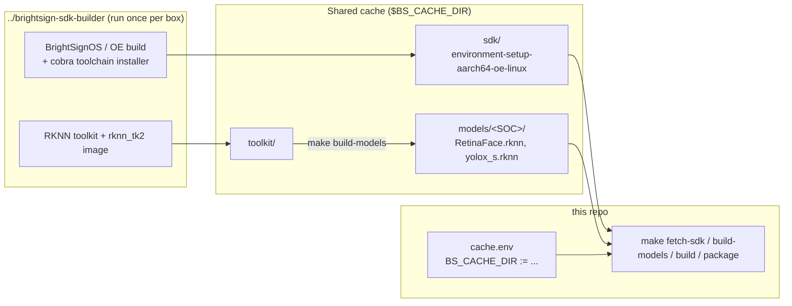

# Prerequisites: SDK, Shared Build Cache, and Repo Configuration

> **TL;DR** — This repo does **not** contain the cross-compile SDK, the RKNN
> toolkit, or the compiled models. They live in a **shared build cache outside
> the repo**, built once per box by the sibling **`brightsign-sdk-builder`** repo
> and reused by every BrightSign NPU project. On a box that already has the cache:
> set `BS_CACHE_DIR` in `cache.env`, run `make cache-info`, then `make package`.

This extension is a **consumer** of the shared cache. It never builds the SDK; it
detects the cached assets and cross-compiles against them.



---

## Supported targets

| Player family | SoC | `TARGET_SOC` | Build dir |
|---------------|-----|--------------|-----------|
| XT5 (XT1145 / XT2145) | RK3588 | `rk3588` | `build_xt5` |
| (RK3576 family)       | RK3576 | `rk3576` | `build_rk3576` |
| LS5 (LS445)           | RK3568 | `rk3568` | `build_ls5` |

`make build` builds all three by default; limit with `make build SOCS="rk3588"`.
The SoC-to-build-dir mapping lives in `scripts/build.sh` and `./package` and must
stay in sync.

The on-device extension is **`ext_npu_argus`** (installed at
`/var/volatile/bsext/ext_npu_argus/`); the primary binary is **`attention_demo`**.

> **Note:** Unlike the voice/LLM extension, Argus links everything it needs
> (OpenCV, RGA, turbojpeg, GStreamer) directly from the base SDK sysroot. It needs
> **no extra cross-built sysroot libraries**, so there is no `sdk-libs` step.

---

## Prerequisites (host)

- **x86_64 Linux** (Ubuntu/Debian assumed).
- **Docker** — used by `brightsign-sdk-builder` and by `make build-models`
  (the `rknn_tk2` image).
- **~25 GB free disk** for the SDK, toolkit clones, Docker images, and models.
- Host tools: `git wget tar cmake make unzip zip mksquashfs`, plus `sshpass`
  for `make copy`.
- Network access to the BrightSign SDK source, GitHub (rknn_model_zoo), and
  (at build time) mosquitto.org for the broker source.

---

## Phase 1 — Populate the shared cache (once per build box)

The heavy, box-level provisioning (the cross-compile SDK) lives in the sibling
**`brightsign-sdk-builder`** repo. **You normally do not run it by hand:** when the
cache is configured but has no SDK, `make fetch-sdk` (a dependency of `make build`
and `make package`) **auto-builds it from source into the cache** — so a fresh box
just needs `make package`.

Auto-build locates the builder next to this repo or next to the cache; override
with `SDK_BUILDER_DIR=/path/to/brightsign-sdk-builder`. It is a one-time,
Docker-based BrightSign OS build (network + ~25 GB, **hours**). To provision it
yourself instead — or to disable auto-build — do one of:

```bash
make build SDK_AUTO_BUILD=0            # skip auto-build; print manual instructions
make -C /path/to/brightsign-sdk-builder build ARGUS_CACHE_DIR=$BS_CACHE_DIR   # build it yourself
```

Then compile the RKNN models into the cache (needs Docker):

```bash
make build-models     # RetinaFace + YOLOX, per SoC, into $BS_CACHE_DIR/models/<SOC>/
```

The RKNN toolkit and model zoo are pinned to **v2.3.2**. `make build-models` is a
no-op once the models are present; force a rebuild with `FORCE_UPDATE=1`.

> **Note:** the builder is a separate repo and still uses its own `ARGUS_CACHE_DIR`
> variable. Auto-build passes this repo's resolved cache path to it automatically,
> so both fill the same `$BS_CACHE_DIR`.

---

## Phase 2 — Configure this repo

Point this repo at the cache the builder filled:

```bash
cp cache.env.example cache.env
# edit cache.env:  BS_CACHE_DIR := /abs/path/to/argus-build-cache
make cache-info       # shows the resolved cache and whether sdk/toolkit/models are present
make fetch-sdk        # detects (does not build) the SDK in the cache
```

If this repo is checked out **parallel** to `brightsign-sdk-builder`, the default
`../argus-build-cache` resolves automatically and `cache.env` is optional. Set
`BS_CACHE_DIR` only when the cache lives elsewhere. A command-line override wins:
`make package BS_CACHE_DIR=/path`.

---

## Build, test, package

```bash
make run-tests        # host-side C++ unit tests (SDK-free)
make build            # cross-compile all SoCs (auto-runs fetch-sdk + sync-models)
make package          # build + produce the extension zips in the repo root
```

`make build` depends on `fetch-sdk` and `sync-models`, so a missing SDK or missing
models stops the build with an actionable message rather than a confusing compile
error.

See **[Build & Installation Guide](BUILD-INSTRUCTIONS.md)** for the full build,
packaging, and on-device install details.

---

## Troubleshooting

| Symptom | Cause | Fix |
|---------|-------|-----|
| `SDK environment not found at .../sdk/environment-setup-...` | Cache not populated or `BS_CACHE_DIR` wrong | Run `make cache-info`; `make fetch-sdk` auto-builds a missing SDK (set `SDK_BUILDER_DIR` if the builder is elsewhere); fix `cache.env`. |
| `make build` stops on missing models | `make build-models` not run | Run `make build-models` (needs Docker). |
| Cache resolves to the wrong path | `cache.env` not set / stale override | `make cache-info` to see the resolved path; set `BS_CACHE_DIR` in `cache.env`. |
| SDK present but "not self-consistent" | SDK relocated for a different cache path | `rm -rf $BS_CACHE_DIR/sdk` and re-run `make fetch-sdk`. |

---

## Why a shared cache?

The SDK, RKNN toolkit, and compiled models are large, slow to produce, and
**identical** across BrightSign NPU projects. Keeping them in a cache outside any
one repo means they are built once per box and reused — the repo stays small, and
every sibling checkout resolves the same `BS_CACHE_DIR`.
