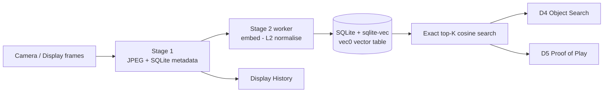

# Visual Memory

Visual Memory is an **optional, off-by-default** subsystem that gives Argus a searchable
visual history on the player itself. It periodically stores JPEG frames with SQLite metadata
(Stage 1) and, when enabled, computes an image embedding for each stored frame and keeps the
vector in the **same SQLite database** so the player can answer *"find the most similar
historical frames"* — entirely on-device, no cloud.

Vectors are tracked in SQLite using the vendored [`sqlite-vec`](https://github.com/asg017/sqlite-vec)
`vec0` virtual table (one table per embedding model, `rowid = frames.id`). Search is an
**exact brute-force cosine KNN**, not an approximate-nearest-neighbour index. Time and source
filters are pushed into the scan so they bound its cost.

Three applications are built on top of the vector store:

- **D4 — Object Search:** index a manually drawn region of interest, then find where that object appears over time.
- **D5 — Proof of Play:** store display-output evidence and verify that registered media actually played.
- **Display History (Phase 2):** capture ~1 fps of the player's own rendered display during registered playback.

Both stages are disabled in the committed config; see the operations guide for how to turn Stage 2 on.

## Document map

### Start here

| Document | What it covers |
|---|---|
| [`libs/visual-memory/README.md`](../libs/visual-memory/README.md) | The `libvisualmemory` library: architecture, full SQLite schema, search semantics, scaling caveats, sqlite-vec ↔ SDK SQLite 3.26.0 compatibility, build options, public API, tests |
| [ARGUS_VISUAL_MEMORY_DESIGN.md](ARGUS_VISUAL_MEMORY_DESIGN.md) | Architecture, storage layout, RAM/SD budgets, thread split, vector-search performance, roadmap, risks, and the engineering decision record |

### Operations

| Document | What it covers |
|---|---|
| [VISUAL_MEMORY_OPERATIONS.md](VISUAL_MEMORY_OPERATIONS.md) | Operating notes and troubleshooting; how to turn Stage 2 (embeddings) on, bounded backfill, deployment procedure |
| [VISUAL_MEMORY_DEMO.md](VISUAL_MEMORY_DEMO.md) | Repeatable stakeholder demo procedure (D1–D3) |

### Dashboard

| Document | What it covers |
|---|---|
| [VISUAL_MEMORY_DASHBOARD.md](VISUAL_MEMORY_DASHBOARD.md) | Visual Memory in the Argus dashboard (D1–D3) |
| [VISUAL_MEMORY_DASHBOARD_API.md](VISUAL_MEMORY_DASHBOARD_API.md) | Dashboard API for Visual Memory (D1–D3) |

### Applications (D4 / D5 / Display History)

| Document | What it covers |
|---|---|
| [VISUAL_MEMORY_OBJECT_SEARCH.md](VISUAL_MEMORY_OBJECT_SEARCH.md) | D4 — Object Search over a manually drawn region of interest |
| [VISUAL_MEMORY_PROOF_OF_PLAY.md](VISUAL_MEMORY_PROOF_OF_PLAY.md) | D5 — Proof of Play: display-output evidence and verification engine |
| [VISUAL_MEMORY_DISPLAY_HISTORY_PHASE2.md](VISUAL_MEMORY_DISPLAY_HISTORY_PHASE2.md) | Display history (Phase 2): ~1 fps of rendered display during registered playback |
| [VISUAL_SEARCH_DISPLAY_SOURCE.md](VISUAL_SEARCH_DISPLAY_SOURCE.md) | Visual Search source: BrightSign Display (Weston/VOP2) — Phase 1 |
| [ARGUS_D1_D5_FINAL_LIVE_DEMO.md](ARGUS_D1_D5_FINAL_LIVE_DEMO.md) | Operator runbook for the full D1–D5 live demo (XT5) |

### Results and models

| Document | What it covers |
|---|---|
| [`libs/visual-memory/STAGE2_RESULTS.md`](../libs/visual-memory/STAGE2_RESULTS.md) | Measured XT5 / RK3588 results: FPS/RSS/CPU impact, embedding fidelity, storage, search latency |
| [`libs/visual-memory/models/README.md`](../libs/visual-memory/models/README.md) | MobileNetV2 embedding model: provenance, hashes, licence, export/convert scripts |
| [`libs/visual-memory/BACKLOG.md`](../libs/visual-memory/BACKLOG.md) | Known, deliberately deferred work |

### Implementation history

| Document | What it covers |
|---|---|
| [COPILOT_VISUAL_MEMORY_IMPLEMENTATION.md](COPILOT_VISUAL_MEMORY_IMPLEMENTATION.md) | Original implementation brief for `libvisualmemory` (historical; design is authoritative in the two "Start here" docs) |
